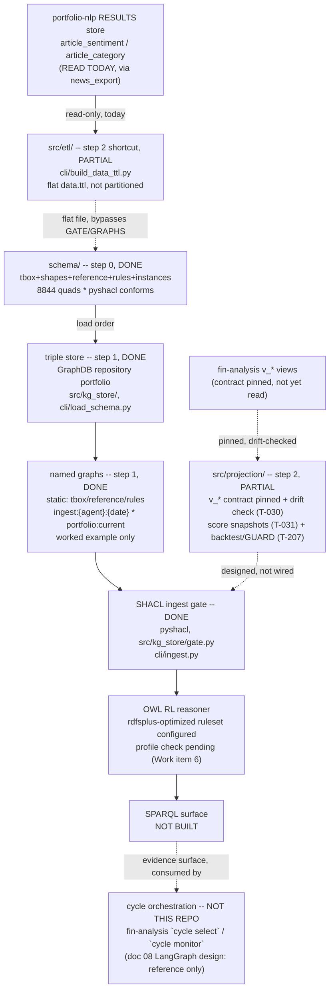

# SPEC.md — `portfolio-knowledge-graph`

Part of the thesis *"Sistema inteligente para la optimización de la inversión
en portafolios mediante integración de información financiera estructurada y
no estructurada de acciones del S&P500"* — Gabriel Jaime Múnera González &
Dovaribi Carupia Yagari, Universidad Pontificia Bolivariana (UPB). Referred
to elsewhere in this document and the architecture artifacts by its working
nickname, "Portfolio Thesis."

The technical contract for this repository: requirements, architecture, data
model, and acceptance criteria. Where `.specify/memory/constitution.md` is
the philosophy/principles/code-style layer this repo commits to regardless of
feature, this document is the "what, precisely" layer for the system it
implements — every requirement below should be traceable to a test, and every
design decision should be explainable by a principle in the constitution.
Link liberally: a design choice justified by, e.g., the constitution's
Architecture or Security & Data principles is annotated `(constitution: …)`
below rather than re-argued here.

Requirement IDs (`FR-0xx` functional, `NR-0xx` non-functional) are stable —
don't renumber an existing one, even if it's later superseded; mark it
superseded in place instead. Reference them in commits/PRs/tests
(`test_two_tier.py::test_source_readonly  # FR-005`) so a reviewer can trace
implementation back to requirement and requirement back to test.

---

## 1. Overview & Purpose

`portfolio-knowledge-graph` is the semantic layer of a six-repository system
(the "Portfolio Thesis") that builds and maintains an S&P 500 portfolio on
top of a knowledge graph. Data flows in one direction through the system:

```
sources (Wikipedia, via `portfolio-data-mining`/news/Finnhub/SEC EDGAR)
  → portfolio-data-mining      (acquisition: discovers URLs, extracts article text)
  → portfolio-nlp              (semantic layer: sentiment/NER/category/summaries)
  → portfolio-financial-analysis (fundamentals/pricing/cycle/quant → SEMANTIC score input)
  → portfolio-knowledge-graph   (THIS REPO — RDF/OWL projection + SPARQL evidence surface)
  → portfolio-reports          (as-of run engine, per-name evidence, HTML report)
  → portfolio-app                (thin Streamlit client)
```

with one feedback edge running back up (a user-defined decision criterion,
compiled once in `reports` and propagated into `financial-analysis` and the
knowledge graph) — out of scope for this repo, noted here only for context.

**What this repo is for**: a portfolio decision needs one auditable place
that ties every signal — universe membership, fundamentals, sentiment, risk
events, veto outcomes, portfolio history — back to *why* it's true and *when*
it became true. `portfolio-knowledge-graph` defines and hosts the formal
RDF/OWL/SHACL ontology (`schema/`) every other repo's data is meant to be
projected into (roadmap step 0, done), the named-graph topology and reasoning
profile that makes that projection queryable and bitemporal
(`07-ontology-topology.md`, designed), and — as a first, narrower cut ahead of
the full projection (roadmap step 2, partially begun) — an ETL
(`src/etl/`) that turns `portfolio-data-mining`'s point-in-time `universe.db` plus
`portfolio-nlp`'s already-published sentiment/category results into a
single-shot, flat `data.ttl` load, so that the ontology has *some* real data
to validate against before the target architecture (a standing triple store,
a SHACL ingest gate, an OWL RL reasoner, a SPARQL surface) is built out.

**Scope principle (maintainer decision, recorded 2026-10-02 from the T-007
upstream-repo scan)**: this repo is **purely integrative**. It defines the
ontology, projects its siblings' already-computed outputs into it,
SHACL-validates what goes in, and exposes the result for query. All
computation — acquisition, NLP, fundamentals, pricing, scoring, vetoes,
ranking, portfolio construction, entity resolution, the Markowitz benchmark —
is done by `portfolio-data-mining`, `portfolio-nlp` and
`portfolio-financial-analysis`; if a capability needs a model, a formula or a
scheduler, it belongs in one of those, not here. §2.5 is the ownership map.

**Transitional exception**: `src/etl/` (§2.1, FR-004–FR-006) is a temporary
compatibility path. Its existing computations — per-article Sentiment
`ScoreSnapshot`s and the severity-derived, gated `:RiskEvent`s — remain
allowed, and are not a violation of the principle above, until the Work item 4
projection replaces it. The Sentiment snapshots are then replaced by the
projected upstream SEMANTIC row; no upstream view corresponds to `:RiskEvent`
(none appears in the §2.5 view list), so its replacement or retirement is an
open decision for Work item 4, not something this exception settles.

**What this repo is explicitly not**: it does not compute fundamentals,
pricing, cycle rankings, or quant scores (`portfolio-financial-analysis`'s
job); it does not run any NLP model or own article source text — it reads
only `portfolio-nlp`'s already-published RESULTS rows, read-only, never
`portfolio-nlp`'s SOURCE text or its own model inference; it stands up the
triple store and its SHACL ingest gate (Work item 3, roadmap step 1) but does
not (yet) verify the OWL RL reasoning or offer a query surface beyond the
store's raw SPARQL endpoint (Work item 6); the reports-agent query catalog
(T-240–T-243) documents scoped queries but does not stand up an endpoint, and
it builds neither of the two
LangGraph agent cycles meant to read all of the above
(`08-agent-architecture.md`, design reference only — roadmap steps 3–8 are
built upstream); it makes no portfolio or trading decision and renders no report
(`portfolio-reports`/`portfolio-app`'s job).

## 2. Scope & Requirements

### 2.1 In scope

- The formal ontology bundle in `schema/`: `tbox.ttl` (72 classes — 58
  mutually-disjoint leaves under a 13-class `rdfs:subClassOf` backbone plus
  `:ExchangeTradedFund` under `:Asset`),
  `shapes.ttl` (57 named SHACL node shapes), `reference.ttl` (GICS taxonomy + 6
  worked-example assets + the `MetricType` vocabulary), `rules.ttl` (10
  active selection rules as `RuleDefinition`s, 6 GUARD protection rules in their own section,
  the 8 superseded definitions kept closed with `validTo`, + `AttractivenessWeightScheme`),
  `instances.trig` (a 16-named-graph worked-example ABox) — roadmap step 0,
  done and verified (**8844 quads, `pyshacl conforms: True**). The FIBO 2026Q2
  glossary slice `fibo.ttl` is a separate 277-statement reference graph loaded
  into `urn:graph:reference:fibo` (T-211).
- The five numbered architecture/spec docs (`06`–`10`) plus
  `critique-and-evolution.md` as the traceability anchor every class/
  property/graph-placement decision elsewhere cites back to.
- The reports-agent query catalog (`docs/reports-agent-query-catalog.md`,
  T-240–T-243): the scoped SPARQL for the Appendix A term lookups and the
  backtest battery, the limits of what the graph can answer (the brief's 11
  evaluation questions, including the not-projected-yet cases), and the
  hermetic test `tests/test_query_catalog.py` that runs every tagged query.
  It is a document, not a service: no endpoint, no new package and no
  computation.
- The step-2 ETL (`src/etl/`, entry `cli/build_data_ttl.py`):
  `portfolio-data-mining`'s `universe.db` → `:Asset`/`:classifiedAs` (every
  symbol ever in the index, minus tickers `reference.ttl` already declares) and
  one `:UniverseMembership` per membership stint + `portfolio-nlp`'s
  RESULTS store (via `portfolio_common.news_export`, read-only) →
  `:NewsArticle` / `:ScoreSnapshot` (Sentiment) / `:RiskEvent` (gated) — a
  single-shot flat `data.ttl`, not the named-graph-partitioned target
  architecture.
- The store (`src/kg_store/`, Work item 3, roadmap step 1): a GraphDB repository
  `portfolio` with the `rdfsplus-optimized` ruleset (`docs/graphdb-setup.md`),
  `schema/` loaded into its named graphs (`cli/load_schema.py`), and the SHACL
  ingest gate (`gate.py`, `cli/ingest.py`) every ABox write passes; acceptance
  via `cli/verify_store.py`. The production repository loads the schema files only;
  `instances.trig`'s worked example stays in `portfolio_test` and other non-production
  repositories. Every CLI that opens the store prints its host/repository target first
  (Work item 39).
- The start of the real step-2 projection (`src/projection/`, Work item 4,
  T-030): the pinned `v_*` read contract (`view_contract.py`), its drift check
  (`cli/check_view_contract.py`), the 0–100 → [0, 1] score conversion
  (`score_scale.py`, §2.6) and the boundary expectations, one JSON file per
  view under `view_expectations/` read by `expectations.py` (T-162, §13 item
  10). `v_score_snapshot` projects into dated ingest graphs (T-031) and the
  eight m018 backtest/GUARD views project into
  `urn:graph:derived:backtest:{run_label}:{window_id}:{backtest_run_id}` (T-207, labelled by
  T-231); the other lanes remain (Work item 4).
- The read-only backtest verifier (`src/projection/verify_backtest.py`, CLI
  `cli/verify_backtest.py`, T-280; Work item 29 adds the selection graph and its cross-graph
  check), the one-command load (`src/projection/load_run.py`, CLI `cli/load_run.py`, Work item 29;
  the six-window delivery, manifest, configuration and metadata graph in Work item 35) and the
  final-load runbook (`docs/backtest-load-runbook.md`): the verifier re-projects the source
  database in memory and compares it with one named graph using SPARQL `SELECT` only; `load_run`
  verifies `SHA256SUMS` and `config_<label>.md`, runs the contract check, both dry runs, both
  writes and the metadata graph and every verification in order; the runbook covers the schema and
  catalog prerequisites, the one-command flow and manual fallback, the production guard, the
  six-window order, recording the numbers and a single-graph rollback (T-281–T-283, T-390–T-398,
  T-520–T-529).
- Keeping the schema and its companion docs internally consistent: the exact
  class/shape/graph/quad counts asserted in `06`/`07` and `schema/README.md`
  must stay in sync with `tbox.ttl`/`shapes.ttl`/`instances.trig` after any
  edit — validated by the parse-and-conform check below.
- *Planned, not built (FR-007, Work item 17):* one GraphDB repository per
  automation (one realization of the algorithm), so a re-run is a new
  automation and no ingest graph is replaced.

### 2.2 Out of scope

- Verified OWL RL reasoning and the SPARQL query surface — designed in
  `07`/`08`, not built (Work item 6). The triple store, its named graphs and
  the SHACL ingest gate were out of scope here originally; they moved in scope
  and are built (Work item 3, roadmap step 1; §2.1), and the projection that
  writes dated `ingest:{agent}:{date}` graphs from real data is Work item 4.
- Computing fundamentals, pricing, cycle rankings, or quant scores
  (`portfolio-financial-analysis`).
- Running any NLP model, discovering/crawling article URLs, or re-deriving
  from source data anything the processed stores already publish
  (`portfolio-nlp`'s RESULTS, `portfolio-financial-analysis`'s `v_*` views):
  this repo reads those outputs where they exist (FR-005). Reading SOURCE
  itself is allowed, read-only. Today the transitional ETL reads `articles`
  through the shared join and scans `body_text` for its provisional G3
  hard-trigger keyword bump, which no processed store publishes (§13 item 12).
- The two LangGraph agent cycles (`SelectionCycleGraph` quarterly,
  `MonitoringCycleGraph` daily) and any scheduler — the two-speed cycle is
  already implemented upstream as `portfolio-financial-analysis`'s `cycle`
  package (`cycle select` / `cycle monitor`, checkpointed, T-1 contagion-
  lagged); this repo builds no orchestrator. No scheduler exists upstream
  either (its own §14 puts one out of scope); the maintainer has assigned
  triggering the quarterly/daily cycles to the future `portfolio-app`
  (§2.6 D9, PLAN Work item 7).
- The SEMANTIC per-`(asset, day)` aggregation — owned by `portfolio-nlp`,
  materialized as `score_snapshot[SEMANTIC]` by `portfolio-financial-analysis`;
  this repo only projects the resulting row (§2.5, PLAN Work item 5). The
  materialization is disputed by upstream's reply of 2026-10-06 (§2.6 D14,
  T-158).
- Entity resolution (`sharedExecutiveWith`), portfolio construction, sector
  scoring and the Markowitz benchmark (roadmap steps 7–8) — built upstream in
  `portfolio-financial-analysis` (`entity_resolution`, `cycle`, `quant`);
  here they exist only as projected `v_*` rows.
- SEC EDGAR filings/sections, pricing/trading data, `:Executive` individuals,
  `article_summary`/`sector_summary` ingestion, and entity extraction beyond
  sentiment/category — all explicitly excluded from the current ETL phase
  (`src/etl/README.md`'s scope table).
- Backtesting (roadmap step 9) and any UI (`portfolio-app`) or report
  rendering (`portfolio-reports`).

### 2.3 Functional requirements

| ID | Requirement | Acceptance criteria |
|---|---|---|
| **FR-001** | The `tbox.ttl`/`shapes.ttl`/`reference.ttl`/`rules.ttl`/`labels.ttl`/`instances.trig` bundle parses as a single `rdflib.Dataset` in the documented load order and `pyshacl`-conforms against `shapes.ttl`. | The `schema/README.md` parse script reports `quads: 8844`; a `pyshacl.validate` run over the same combined graph reports `conforms: True` — both required after any schema edit. |
| **FR-002** | Every domain class in `tbox.ttl` that is not a shared-property superclass (`ObservationSnapshot`/`EvidenceSource`/`RuleOperand`) belongs to exactly one `AllDisjointClasses` set and reaches at least one of the 6 taxonomy roots via `rdfs:subClassOf`. | `tbox.ttl`'s `AllDisjointClasses` block lists exactly 58 leaf classes; a taxonomy audit (cycle/orphan/multi-parent detection over the `subClassOf` graph) reports 0 cycles, 0 self-loops, all 72 classes reaching a root, exactly 3 legitimately multi-parented classes (`schema/README.md`'s implementation addendum). |
| **FR-003** | Every `RuleDefinition` in `rules.ttl` expresses its veto condition as an explicit `RuleClause` tree (`AND`/`OR` of `ThresholdComparison`/`CategoricalComparison`/`GraphPredicate` leaves), never as an infix boolean string. | No `RuleDefinition` in `rules.ttl` carries a rule condition as a literal string to be re-parsed; every `hasClause` path terminates in one of the three documented leaf operand kinds. A single leaf (upstream's rules, T-103; nine since T-187) is a valid tree. |
| **FR-004** | `cli/build_data_ttl.py` projects `portfolio-data-mining`'s point-in-time `universe.db` (`SQL_UNIVERSE_DB`, read-only through `portfolio_common.db`) into one `:UniverseMembership` per `universe_membership` stint (`validFrom` = `valid_from`; `validTo` = `valid_to`, INCLUSIVE and the last day of membership, absent while the stint is open) in the single `:SP500Index` `:Universe`, and one `:Asset` per company line for a pure ticker succession (named by the latest symbol, carrying every stint), or per symbol for concurrent share classes, a mixed CIK and a CIK-less stint, with `:classifiedAs` when upstream has a sub-industry. A symbol whose stints are all closed has only `tickerSymbol` and `companyName`: upstream has no CIK or sector for it, and none is invented (`AssetShape` allows a missing `cikNumber` only then). Tickers `reference.ttl` already declares as `:Asset` get memberships but are not re-emitted (so `cikNumber` never collides under the functional-property `sh:maxCount 1` contract). Each run prints `universe.db`'s latest recorded change and its file modification date, because upstream refreshes it by hand. | A full run's `:Asset` count plus `reference.ttl`'s tickers equals `universe.db`'s distinct symbols minus the pure successions it folds; its `:UniverseMembership` count equals `universe_membership`'s rows; none of `reference.ttl`'s tickers appears as a second `:Asset` declaration in `data.ttl`; the run summary prints the freshness line. |
| **FR-005** | `cli/build_data_ttl.py` projects the shared join of SOURCE `articles` with `portfolio-nlp`'s RESULTS `article_sentiment`/`article_category` (`fetch_status = 'ok'`) into `:NewsArticle` + `:ScoreSnapshot` (`agentOrigin = SEMANTIC`, `metricType = Sentiment`) + a gated `:RiskEvent`, via `portfolio_common.news_export`'s read-only connect — never a raw `sqlite3` connection. Reading SOURCE (`urls.db`, `body_text` included) is allowed. What is forbidden is reading a source or raw database for something the processed stores already publish (`portfolio-nlp`'s RESULTS, `portfolio-financial-analysis`'s `financial.db` / `v_*` views), or re-deriving it there: sentiment, category, entities, fundamentals, prices, scores. Those are read from the processed store. A SOURCE-derived signal with no processed equivalent is allowed if it is flagged provisional (constitution §7); today that is only G3's hard-trigger keyword bump (§13 item 12) | `grep -rn "import sqlite3" src/etl` returns nothing; every value `src/etl/` derives from a SOURCE column other than identity and metadata (`id`, `ticker`, `pub_date`, `fetched_at`, `fetch_status`) is a row in `src/etl/README.md`'s provisional-formulas table, which says why no processed store publishes it; every `:NewsArticle` emitted in a sample run traces to a source row with `fetch_status = 'ok'`. |
| **FR-006** | The post-build validation step SHACL-checks either the full output (`--limit` given) or a fresh `KG_SAMPLE_NEWS_ROWS`-row sample against the real `tbox.ttl` + `shapes.ttl` + `reference.ttl` — never a full `pyshacl` pass over the unsampled, multi-million-triple `data.ttl`. | `uv run cli/build_data_ttl.py --limit 500` prints `SHACL conforms: <bool>`; an unsampled default run builds and discards a `KG_SAMPLE_NEWS_ROWS`-row sample file rather than validating `data.ttl` directly. |
| **FR-007** *(planned, Work item 17; not built)* | An **automation** is one realization of the algorithm, with its own GraphDB repository (*proposed, T-196: a generated id plus a unique lower-case human name*). A re-run with other settings, or after a fix, is a new automation; no ingest graph is ever replaced, and the gate's refusal of an existing graph (check 2) is unchanged. | A test with a fake store that records every request shows a delete of one automation issues no request naming another repository, and that `portfolio` is refused for delete and replay. Integration checks, with a live store (Work item 17 steps 2-3, outside the hermetic gate): a second run for the same agent and day is refused under the same automation and written to its own repository under another, the first automation's graphs are untouched, and `verify_store` passes per repository. |
| **FR-008** | `cli/load_universe.py` (logic in `src/kg_store/universe.py`) loads FR-004's asset master into the store **through the ingest gate**, into `urn:graph:universe:{year}-Q{n}` computed from `--as-of` (not `urn:graph:reference`, which `cli/load_schema.py` drops and rewrites on every reload): the `:SP500Index` `:Universe` with its FIBO `rdfs:seeAlso`, one `:Asset` per company line for a pure ticker succession (or per symbol for concurrent classes, a mixed CIK or a CIK-less stint) and one `:UniverseMembership` per stint. It reuses `etl.asset_master` (`read_stints`, `build_assets`, and the shared `resolve_assets`), reads `SQL_UNIVERSE_DB`, and `projection.backtest.universe_assets` uses the same resolver, so the loader and the backtest projector cannot disagree on the asset set. `--since` (default `2019-01-02`) keeps a stint with no `valid_to` or `valid_to >= since`; `validTo` is inclusive, so a point-in-time read on D is `validFrom <= D AND (no validTo OR validTo >= D)`, a one-day stint is real, and a ticker reused by another company (`CEG`, `DELL`, `Q`) is one `:Asset` described by the kept era while the dropped stints are counted. The six `:Asset`/`:ExchangeTradedFund` individuals `reference.ttl` declares get memberships but are never re-declared (gate check 6); SPY has none because it is not an index member. The default is a dry run that reads, builds and SHACL-validates through `gate.validate` without contacting the store; `--write` appends through `gate.ingest` and needs `--to-production` when `KG_REPOSITORY=portfolio`. `--delta` (Work item 28) is the incremental mode: it reads the same source with the same `--since` and `resolve_assets` and the store with `SELECT` only (the stored `:Asset` individuals and the `:SP500Index` `:UniverseMembership` set), then writes only new assets (with their stints), new memberships of stored assets (a re-entry or a symbol that folds into the stored asset by CIK) and `:validTo` closures of stored open memberships, into the next `urn:graph:universe:{year}-Q{n}:delta:{n}`. Drift (a changed `:companyName`, `:cikNumber` or `:classifiedAs`, other membership `:membershipAsset`/`:validFrom`/`:validTo` values, a stored closed membership whose source stint is open, a stored membership or non-reference asset absent from the source) is reported and never applied; a stored typed individual is never re-declared and an empty actionable delta writes nothing. | A dry run over `/workspaces/thesis/data/universe_history_gics.db` at `--since` 2019-01-02 reports 658 of 894 stints kept over 654 symbols (236 stints of 230 symbols dropped; 215 not loaded, 15 with a later stint kept), 643 `:Asset`s written plus the six in `reference.ttl` (649 assets from 654 symbols; six pure successions folded), 658 memberships (503 open, 155 closed) and 6548 triples (with Work item 22's six historical GICS
sub-industry mappings in place, so no unmapped-value warning remains), and `gate.validate` reports
conforms. Every ticker in `v_book_weight_daily` (CASH excluded), `v_guard_alert` and `v_guard_action` of `rule_P1/P2/P3.db` is in the loaded asset set (P1 100, P2 123, P3 115; 0 missing). Hermetic tests cover a ticker's two eras, a CIK-less closed asset, `BRK.B`, a one-day stint, a pure rename chain, concurrent classes, a mixed CIK, ticker reuse, loader/projector agreement, the quarter name, deterministic output, gate acceptance, the production guard and a fake-store write. The delta tests cover a new ticker, a rename that joins a stored asset, a closure (only the `:validTo` triple), a re-entry, drift (changed sector/name/CIK), a stored membership absent from the source, the empty delta, the fresh-store refusal and the gate check 2/6/7 refusals. A read-only delta over `portfolio_test` with the same `universe.db` reports 0 new assets, 0 new memberships, 0 closures and 0 drift; a temporary copy with one new symbol and one closed open stint reports exactly 1 new asset, 1 new membership and 1 closure with 0 drift, and the run is idempotent after a write. Live 2026-11-04 in `portfolio_test`: after the schema reload from master following PR #123 (`verify_store` 6/6 PASS), the full load wrote 643 `:Asset` plus the 5 in `reference.ttl`, 658 memberships (503 open, 155 closed) and 6548 triples into `urn:graph:universe:2026-Q4`; 59 assets were left without `:classifiedAs` on purpose. See `docs/graphdb-setup.md`, "Live load record, portfolio_test, 2026-11-04". |
| **FR-009** | `cli/verify_backtest.py` (logic in `src/projection/verify_backtest.py`) is a **read-only** verifier for one loaded backtest graph: it takes an explicit `--graph`, `--db` and `--label`, reads the repository from the same environment as the other store CLIs, and re-projects the source database in memory through the same projector before comparing the result with the store. It only issues SPARQL `SELECT` queries, prints the repository and graph it checked, one `PASS`/`FAIL` line per check, and exits 0 only when every check passes. An m018 graph uses `projection.backtest.project_source` and keeps its original checks: graph name and stored `:runLabel`/`:windowId`/`:backtestRunId`, total triples, the eight classes' individual counts, distinct `:holdingAsset`/`:guardAsset` tickers and the unlinked-row ceiling, GuardAlert groups by rule/layer/state, GuardAction by status, last NAV per arm, CASH rows, `:runLabel` through the book and `:knowledgeDate`. Work item 34 adds two: every period summary's `:nGuardActions` equals the `APPLIED` guard actions of its book whose `decision_date` lies inside `[dateFrom, dateTo]` inclusive, recomputed from both the source and the graph; and the Basing Points alert count equals the source with zero `:alertThreshold` triples on them (their threshold is an asset stop price level). A selection graph uses `projection.backtest.project_selection_source` and checks its name and stored `SelectionCycle` identity, total triples, one individual per projected source row for `SelectionCycle` (`v_cycle_run`), `AttractivenessSnapshot` (`v_cycle_ranking`), effective-weight `WeightComponent` (`v_cycle_ranking_component`), `AttractivenessWeightScheme` (`v_weight_scheme`), configured `WeightComponent` (`v_weight_component`) and `Veto` (`v_veto`); the UNSCORED/UNPRICED placeholder count; `:attractivenessOfAsset`/`:vetoOfAsset` links and the unlinked-ticker ceiling; vetoes grouped by resolved rule; and the cross-graph check that every `:cycleRunId` of a TOPN `BookRebalance` in the m018 graph has its `SelectionCycle` (the `MARKOWITZ` arms have none). `docs/backtest-load-runbook.md` is the companion procedure for the final load. | The verifier's hermetic tests (an in-memory `rdflib.Dataset` as the store) pass both a correct m018 and a correct selection graph and fail a missing class, an altered individual count, a missing link, a wrong label, a wrong graph name and a missing cross-graph cycle; the CLI's argument contract is run as a subprocess. The verifier over the real `rule_P1.db` projections in an in-memory Dataset passes 23/23 m018 checks over 209,886 triples and 15/15 selection checks over 321,324 triples. The runbook's 2026-11-04 read-only `cli/load_run.py` dry runs report `rule_P1.db` 15,615 `v_book_weight_daily` rows, 209,886 m018 triples, 42,700 selection rows and 321,324 selection triples in 93.2 s at 1.16 GB peak RSS; `rule_P2.db` 15,641, 196,840, 41,259, 309,728, 90.2 s, 1.10 GB; and `rule_P3.db` 18,025, 222,449, 45,440, 342,934, 101.0 s, 1.22 GB. The runbook states the asset catalog's one-time limit and the single-graph rollback for both graph kinds. Live 2026-11-04 in `portfolio_test` with label `rule`: the m018 graphs hold 209,886 / 196,840 / 222,449 triples (P1/P2/P3) and pass 21/21 checks each; the selection graphs hold 321,324 / 309,728 / 342,934 triples and pass 15/15 each. The ticker-history snapshot and the selection per-class counts are in `docs/graphdb-setup.md`, "Live load record, portfolio_test, 2026-11-04". |
| **FR-010** | The ingest gate's context fetch (`gate.context_predicates`) chooses the properties it reads for a referenced individual from the relation's `sh:class` first and, when none is declared, from the relation's `rdfs:range` in the TBox. A relation with neither still fetches only `rdf:type`. The three projection CLIs (`project_selection.py`, `project_backtest.py`, `project_reference.py`) accept read-only `--check-store`: build each graph and call the same `gate.plan` a write uses, with SPARQL `SELECT` only. The plan runs the shape/context validation (`fetch_context`), the append-only target's existence (check 2), the typed individuals already stored (check 6) and the closing-state checks (check 7); the CLI prints `would-be-written`, `already-in-the-store` (skipped) or `refused`, and writes nothing. `--check-store` cannot be combined with `--write` or `--to-production`; `--delta`'s dry run runs the same plan. `cli/load_run.py --check-store` runs the same plan for every m018 and selection graph of every `--db`/`--dir` database in one read-only pass, with the same three statuses; its `--write` path plans every graph before writing any of them. The first live selection write had been refused before Work item 30 because the fetched context held only `rdf:type`; `--check-store` is the pre-flight that shows that refusal before a write. | The regression test builds a selection batch from the synthetic fixture and runs the real `gate.fetch_context` against an in-memory Dataset holding `rules.ttl` and an asset catalog: the fetched context carries `cikNumber`/`tickerSymbol`/`hasUniverseMembership` and `ruleId`/`category`/`ruleSeverity`/`hasClause`, the batch conforms, and a veto pointing at a GUARD rule is refused. `tickerHistoryAsset`, `holdingAsset` and `guardAsset` keep fetching the AssetShape predicates. `gate.plan` returns `already-in-the-store` for an existing append-only graph, refuses an individual already stored (check 6) and refuses a closing triple the store cannot take (check 7); `gate.write` applies a would-write plan, and `store_check.check_graphs` reports all three statuses. A read-only `--check-store` run against `portfolio_test` accepted the selection and m018 graphs for P1/P2/P3 and the ticker-history snapshot; `tests/test_load_run.py` runs the same real plan/write path for every load_run status. |
| **FR-011** | `cli/load_run.py` (logic in `src/projection/load_run.py`) loads one labelled backtest delivery in one command. It takes `--label` plus a `--dir DIR` (or legacy `--db PATH`), discovers `<label>_<window>.db` for the six allowed windows (`P1`, `H1`, `P3`, `H2`, `P2`, `H3`; any subset, `--windows` requires named ones), verifies `SHA256SUMS` (sha256sum format, 1 MiB streaming, case-insensitive compare, lowercase stored) before any database is opened, reads `config_<label>.md` (string front matter, required `label`/`code_commit`/`pr`/`results_doc`, optional `config_id`/`status`, unknown keys as warnings, body byte-for-byte) and orders the windows chronologically by `v_book.d_start`/`d_end` (`P3` before `P2`). It then runs, stopping at the first failure: the optional `--contract TARGET` view-contract check; a dry run of both projectors (`projection.backtest.run` and `run_selection`, counts and unlinked rows printed) plus SHACL validation of the metadata batch; the read-only pre-flight, which calls `gate.plan` for **every** m018, selection and metadata graph with the store's real context and `SELECT` only and reports `would-be-written`, `already-in-the-store` (skipped) or `refused`; with `--write`, only after every graph is accepted, the plans the pre-flight already computed applied with `gate.write` (all m018 graphs first, then the selection siblings, then `urn:graph:derived:backtest:meta:{label}`; no second plan, and an already-stored graph is skipped); and `projection.verify_backtest.verify` for every data graph plus `projection.run_metadata.verify_metadata` for the metadata graph. The metadata graph holds one `:BacktestRun` per window (label, window, run id, source file, lowercase SHA-256, knowledge date, configuration link) and one `:RunConfiguration` (required/optional front-matter fields and the body in `rdfs:comment`). A refused pre-flight writes nothing and lists each refusal with its graph name and the gate's message. `--check-store` runs only the pre-flight, writes nothing and refuses `--write` and `--to-production`. It reuses the existing projector, gate and verifier code, keeps `--to-production` for a production write (production receives only the `final` label), refuses two inputs that would write the same graph, prints per-step and per-window timings, flags a window over 30 minutes as `STOP AND ASK upstream`, prints a final `graph / triples / status / checks passed` table, and exits non-zero on any failure. It never drops a graph: on a verification failure, or a write failure after the pre-flight, it prints the exact one-graph `DROP GRAPH <iri>` commands for the graphs it wrote; a write failure also names the graph in doubt when the store's answer was lost. `--no-manifest --no-config` is the pilot's explicit legacy mode and builds no metadata graph; a present delivery file is never ignored. | `tests/test_load_run.py` and `tests/test_load_run_delivery.py` use the in-memory `DatasetStore` with the typed assets and real `schema/rules.ttl` in the store, so `gate.plan` runs the real `fetch_context`: all accepted graphs are written and verified; the six-window folder is processed chronologically (`P3` before `P2`), the manifest is checked before the store is contacted, a manifest mismatch/missing entry/missing file, an unknown or missing window, a config label mismatch and a second write are refused; the metadata graph holds one run per window and one configuration whose body round-trips; a low-disk HTTP 500 names the graph and prints its `DROP GRAPH`; and a window over 30 minutes is flagged. The existing load_run tests stay green. A read-only `--check-store` run against `portfolio_test` with the three `rule_P*.db` files reports the six m018/selection graphs as `already-in-the-store`; a dry run contacts no store. The 2026-11-05 read-only pilot re-check processed the same folder in `P1` → `P3` → `P2` order and reported the six graphs `already-in-the-store` with `--no-manifest --no-config`; no GraphDB write was made. |
| **FR-012** | Every CLI that opens GraphDB (`load_schema`, `verify_store`, `ingest`, `load_universe`, `load_run`, `load_aggregates`, `load_mv_base`, `project_backtest`, `project_selection`, `project_reference`, `project_scores`, `verify_backtest`) prints, as its first output line, the target host and repository and whether it is the production repository; a dry run that contacts no store prints no banner, and `KG_USER`/`KG_PASSWORD` are never printed. When `KG_HOST` or `KG_REPOSITORY` is present in the process environment with a different value than `.env`, one warning line names the variable and both values (the process environment still wins, as `load_dotenv(override=False)` says). `cli/load_schema.py` and `cli/verify_store.py` take `--to-production`: with `KG_REPOSITORY=portfolio` and no flag they exit 2 before any request, and `load_schema` (which always writes) never sends `instances.trig` to production. | Hermetic subprocess tests prove the banner is first, contains host/repository/production and no credentials; the override warning appears only when the values differ; both commands exit 2 on production without the flag and proceed past the guard with it; a production load sends no `instances.trig` bytes and verifies the five schema graphs, while a non-production load keeps the 21 graphs including the examples. `verify_store`'s six acceptance checks stay consistent with the load: production's schema-graphs check expects the five schema graphs, and its reasoning/stored-vocabulary checks use the TBox and `rules.ttl` rather than an example individual. |

### 2.4 Non-functional requirements

| ID | Requirement | Acceptance criteria |
|---|---|---|
| **NR-001** | The ontology's and its companion docs' asserted counts (class/shape/graph/quad totals) stay in sync after any schema edit. | `schema/README.md`'s stated counts match a fresh run of the FR-001 parse+`pyshacl` check; a PR changing `tbox.ttl`/`shapes.ttl`/`instances.trig` without updating the doc's numbers is incomplete. |
| **NR-002** | A database-engine change (away from SQLite, or a `portfolio-common` results-contract bump) must not require touching this repo's ETL logic beyond a version/tag bump. | `grep -rn "import sqlite3" src` returns nothing; the only engine-specific access goes through `portfolio_common.db`/`portfolio_common.news_export`. |
| **NR-003** | Raw OHLCV/tick-level price data never enters the ontology or the ETL output (`07-ontology-topology.md`'s explicit warning). | `tbox.ttl` defines no tick-level price class; `grep` for a raw-bar/tick field name in `schema/` or `src/etl/` returns nothing beyond the bounded `PriceObservation` summary class. |
| **NR-004** | The IRI namespace stays `https://thesis.local/kg/portfolio#` for every new term across `schema/*.ttl`/`.trig` unless deliberately aligning to an external vocabulary. | A bare `owl:Class`/`owl:ObjectProperty`/`owl:DatatypeProperty` declaration outside that namespace, excluding the documented FIBO `rdfs:seeAlso` and GICS `skos:Concept` alignments, does not occur. |
| **NR-005** | Two automated gates exist and no CI workflow is configured: the hermetic `pytest` suite (`uv run pytest`; constitution Project structure #10) and, inside it, the FR-001 `rdflib` parse + `pyshacl` conformance check (`tests/test_schema_gate.py`, T-134). Both are run locally before merge. | `uv run pytest` passes on a clean checkout, and `tests/test_schema_gate.py` fails if the schema stops parsing or conforming, if a deliberately broken `:Asset` is not rejected, or if any quad count or the named-graph count this SPEC states drifts from the real one. This NR records that nothing runs them in CI (§11, §14), so that absence is a documented decision, not an oversight. |

### 2.5 Scope boundary — what this repo owns vs. consumes

Established by the T-007 scan (2026-10-02) of `portfolio-data-mining`,
`portfolio-nlp` and `portfolio-financial-analysis` (READMEs + their own
`SPEC.md`s; read, not executed).

| Repo | Computes / owns | Surface this repo may consume | Consumed today? |
|---|---|---|---|
| `portfolio-data-mining` | News URL discovery and article text extraction (`news_collector`, `extractor` → `urls.db`); Finnhub/yfinance pricing HTTP service (`pricing`: `GET /pricing/{ticker}`, `/pricing/{ticker}/actions`, `/universe`); SEC EDGAR HTTP service (`sec_edgar`); the S&P 500 universe, live (`data_mining.portfolio`) and **point-in-time** (`data_mining.universe_history` → `universe.db`, SCD-2 `universe_membership`) | `universe.db` — the point-in-time membership every upstream agent already reads read-only (D1); its HTTP services and `urls.db` are consumed by the other two repos; `src/etl/` also reads `urls.db` through `news_export` (FR-005, §13 item 12) | Yes — `universe.db` by `src/etl/` (FR-004, T-100); `urls.db` transitionally via `news_export` (FR-005); the HTTP services stay indirect (§12) |
| `portfolio-nlp` | Sentiment (FinBERT), NER, category, summaries → `nlp.db` (`article_sentiment`/`article_entities`/`article_category`/`article_summary`/`sector_summary`); proposed owner of the per-`(asset, day)` SEMANTIC aggregation (not built) | `nlp.db` RESULTS, read-only | Yes — `src/etl/` via `portfolio_common.news_export` |
| `portfolio-financial-analysis` | `fundamental_agent` (EDGAR ratios + LLM assessment, Ring-1 `DQ_*` data-quality gates), `pricing_agent`, `cycle` (a checkpointed topological runner — Strands-era, not LangGraph: TECHNICAL/VALORIZATION/SECTOR scores, veto stints, ranking, positions, `backfill` replay), `entity_resolution` (news-co-occurrence *candidates*, projected as `AssetCoOccurrence`, T-107), `quant` (Markowitz benchmark books, forward evaluation; finished view-exposed numbers projected as benchmark `Portfolio`s and `BenchmarkObservation`s, T-108), read-only HTTP `api/` (:8010); passive `kg_schema` (DDL, migrations, `schema_version`, views) | The 31 `v_*` read-contract views over `SQL_FINANCIAL_DB` (SQLite, `mode=ro`): `v_score_snapshot`, `v_sector`, `v_industry`, `v_sector_aggregate_snapshot`, `v_price_observation`, `v_corporate_action`, `v_quant_return_daily`, `v_risk_free_rate`, `v_benchmark_series`, `v_sec_filing`, `v_sec_filing_section`, `v_veto`, `v_rule_catalog`, `v_data_quality_issue`, `v_portfolio_position`, `v_shared_executive_edge`, `v_cycle_ranking`, `v_weight_scheme`, `v_weight_component`, `v_quant_risk_model`, `v_quant_portfolio`, `v_quant_position`, `v_quant_frontier_point`, `v_quant_benchmark_performance`, `v_quant_vs_live`, run logs `v_analysis_run`/`v_pricing_run`/`v_quant_run`/`v_cycle_run`, `v_universe_coverage`, and `v_universe_membership` (**frozen** — use `universe.db`). No view exposes `fundamental_metrics`, `financial_facts` or `filing_cover_shares` | No — designed source, unread (§13 item 2) |
| `portfolio-knowledge-graph` (this repo) | The ontology (`schema/`); the projection of the above into SHACL-validated, dated named graphs; the store, reasoner and SPARQL surface over them | — | — |

Consequences for this repo's scope:

1. **No computation here.** Anything that would compute a score, rank, veto,
   position, sentiment or filing metric is out of scope; this repo
   *represents* it (`:ScoreSnapshot`, `:Veto`, `:PortfolioPosition`, …) with
   provenance back to the upstream `run_id`/`as_of`/`code_version`.
2. **Read upstream through its published contract only** — `nlp.db` RESULTS
   via `portfolio_common.news_export`, and `financial-analysis`'s `v_*` views
   opened read-only (`mode=ro`). Never read an upstream's SOURCE or raw
   tables for something its processed stores already publish, and never
   through a raw connection (NR-002 spirit). SOURCE `urls.db` through
   `news_export` is allowed for a signal no processed store has, flagged
   provisional (FR-005; today only G3's keyword bump, §13 item 12); the
   transitional exception in §1 covers it until Work item 4. `universe.db`
   is a direct, read-only upstream contract (FR-004, §2.6 D1).
3. **The pricing endpoint exists** (`portfolio-data-mining`
   `apps/pricing_api.py`, `GET /pricing/{ticker}`; consumed by
   `portfolio-financial-analysis`'s `pricing_agent`). The roadmap's earlier
   "`src/trading/` is empty / no pricing pipeline anywhere" claim is stale.
   This repo needs no pricing access: only `v_price_observation` summaries
   (NR-003).
4. **`financial-analysis`'s `kg_schema` mirrors much of this ontology's
   vocabulary** (`ScoreSnapshot`, `UniverseMembership`, `PriceObservation`,
   `SECFilingSection`, `Veto`, `PortfolioPosition`, `sharedExecutiveWith`,
   sector aggregates, weight schemes) — but the **semantics differ in
   places that matter** (§2.6: temporal model, veto lifecycle, rule catalog,
   score-type names, edge evidence). It is not a 1:1 mapping job; each
   difference needs a decision before the projection is written (PLAN Work
   item 11).
5. **There is no scheduler in any existing repo.** `financial-analysis`'s own
   §14 makes a scheduler and a cross-module orchestrator out of scope there
   (its Work item 2, an orchestrator, is open). Delegating the cycle upstream
   delegates the *logic* (`cycle select`/`monitor`); the maintainer has
   assigned *triggering* it to `portfolio-app` (not yet created), so the
   cadence is manual until that repo exists.

### 2.6 Upstream drift register (T-007 rescan, 2026-10-02)

The first T-007 pass mapped *who owns what*. This second pass compared
`portfolio-financial-analysis` (and, where it bites, `portfolio-nlp`/
`portfolio-data-mining`) against **this repo's** SPEC, ontology and ETL, to
catch capabilities and semantics that moved on after the ontology was
designed. Sources: those repos' `.specify/memory/SPEC.md`, `docs/*.md`,
`src/kg_schema/{views,ddl,migrations}.py`, `src/cycle/rules/builtin.py`
(read in a shallow clone; **nothing was executed**, so every row is a
documentation/code-reading claim, not a runtime-verified one). Each row
names the decision it forces; the decisions were PLAN Work item 11's backlog
and their dispositions are in the table after the register (T-112).

| # | Upstream fact | This repo today | Why it matters / decision forced |
|---|---|---|---|
| D1 | **Point-in-time S&P 500 universe.** `portfolio-data-mining` keeps `universe.db` (SCD-2 `universe_membership`: `symbol, security, gics_sector, gics_sub_industry, hq_location, date_added, cik, founded, valid_from, valid_to, source`), reconstructed from Wikipedia's "Historical components" change log (`source` = `wikipedia_changes_backfill` \| `live_snapshot`) and refreshed only by manual `universe-backfill`/`universe-snapshot`. Every upstream agent takes `--analysis-date D` and reads membership with `valid_from <= D AND (valid_to IS NULL OR valid_to >= D)` (`valid_to` is the last day of membership; the old `>` predicate was fixed upstream on 2026-10-14), deduped by symbol keeping the latest stint; `financial-analysis`'s own `universe_membership` table and `v_universe_membership` are **frozen**. | FR-004 builds `:Asset`s from Wikipedia's *live* constituent table at ETL run time; no `:UniverseMembership` individual is produced; §12 declared no dependency on `portfolio-data-mining`. `UniverseMembership` (with `validFrom`/`validTo`) already exists in `tbox.ttl`. | The ontology's bitemporal universe has a real source; the ETL ignores it and so cannot represent who was in the index on any past date (survivorship bias). `universe.db` is therefore a **direct upstream contract** (read-only), and a stale `universe.db` between manual snapshots is a known upstream risk. **Decision (maintainer, 2026-10-05): adopt.** The live-scrape asset master is retired in favour of `universe.db` (T-100): every stint becomes a `:UniverseMembership`, every symbol an `:Asset`, and as-of reads are queries over `validFrom`/`validTo` in the graph. Chosen with it: `cikNumber` is optional only for an `:Asset` whose memberships are all closed (no CIK is invented); upstream's `valid_from` is kept as is (`1976-07-01` means "before upstream's records begin"); a news ticker `universe.db` lacks (`EQR`) stays unresolved and is raised upstream; each run prints `universe.db`'s freshness. |
| D2 | **Two-clock model with look-ahead guard.** Rows carry `event_time` (what the row is about) and `available_at` (when usable: first NYSE trading day *after* the filing date, T-107) alongside `computed_at`/`ingested_at`; every as-of reader filters on `available_at`, never `event_time`; `v_score_snapshot.event_time` = filing period-end (FUNDAMENTAL), cycle date (TECHNICAL/VALORIZATION), article-day (SEMANTIC). Only FUNDAMENTAL rows carry `available_at` today; upstream's T-144 fills it in the view with the cycle date for TECHNICAL, VALORIZATION and SECTOR (reply of 2026-10-06). | `ScoreSnapshot` has `timestamp`/`detectedAt`/`provenanceId`; bitemporality is expressed only by dated named graphs (`07`). No `availableAt`/`eventTime` property. | A projection that stamps FUNDAMENTAL scores by filing date or period-end would leak look-ahead into every "as of D" query. **Decided and implemented (T-101, 2026-10-03):** `availableAt` (required) and `eventTime` (optional) are `ScoreSnapshot` properties; `timestamp` is unchanged. |
| D3 | **Veto stints, not events.** `veto` rows are stints (`raised_on`, `cleared_on`, `last_seen_on` = cycle dates; `detected_at`/`cleared_at` wall-clock only); closed, never deleted; a HARD veto *clears* when its rule re-evaluates clean; a SOFT stint charges its rule's `penalty_points` once, or `soft_veto_penalty` if the rule declares none (a HARD rule's SOFT stint included: assumed, not confirmed, T-191 ask (8)); active at cutoff `C` iff `raised_on <= C AND (cleared_on IS NULL OR cleared_on > C)`; the T-1 lag is this predicate applied at read time. | `Veto` has `decidedAt`/`detectedAt`; the T-1 lag was designed as a LangGraph checkpointer mechanism (`08`). | Needs `raisedOn`/`clearedOn`/`lastSeenOn` (or `validFrom`/`validTo`) on `:Veto`, and the T-1 predicate as a SPARQL pattern, not an orchestrator feature (T-102). **Implemented (T-102, 2026-10-03):** `:Veto` carries `raisedOn` (required), `clearedOn`, `lastSeenOn` (multi-valued, current = MAX) and per-stint `vetoSeverity`; `VetoShape` enforces date order; the active-at-cutoff SPARQL is in `schema/README.md`. Upstream `cleared_at` is dropped. |
| D4 | **Different rule catalog.** (As found at T-103; nine rules since T-187, see the adoption row.) Six flat threshold rules in `cycle/rules/builtin.py`: `LEVERAGE_EXTREME` (D/E > 3, HARD), `NEGATIVE_FCF` (HARD), `LIQUIDITY_DISTRESS` (current ratio < 1, SOFT), `PRICE_CRASH` (90d drawdown < −35%, SOFT), `EARNINGS_MISSING` (FUNDAMENTAL score aged > 400d, SOFT), `DATA_QUALITY` (a HARD Ring-1 gate fired, HARD); plus a non-veto `UNSCORED` exclusion in `rank` (T-119). *(Six at the time of the T-103 read; the seventh reply, 2026-10-11, lists nine in their code at `6a80ec3`: see D4 in the adoption table and the rule table below.)* No AND/OR tree (their §13 item 6 accepts that) and **no contagion/`sharedExecutiveWith` rule**. | `rules.ttl` holds 7 `RuleClause`-tree rules (`VETO_FIN_01`, `VETO_LEG_01`, `VETO_COMP_01..03`, `VETO_MKT_02`, `VETO_RED_01`) — different ids, different logic. | `v_veto.rule_id` values (`LEVERAGE_EXTREME`, …) resolve to no `:RuleDefinition`, so a projected `:Veto` would violate `:appliesRule` conformance. Our catalog is a design; upstream's is what actually runs. Decide: add the six as (flat-leaf) `RuleDefinition`s and mark ours as design-only, or reconcile the other way (T-103). **Disposition (maintainer, 2026-10-02): upstream's catalog is final and authoritative** — `portfolio-financial-analysis`'s six rules are preserved as implemented; `rules.ttl`'s seven tree rules are superseded (design history, not a target). **Implemented (T-103, 2026-10-03):** `rules.ttl` carries the six as `RuleDefinition`s whose `hasClause` is a single leaf (`ThresholdComparison`, or a `GraphPredicate` for `DATA_QUALITY`); added `:ruleSeverity` (HARD/SOFT) and the upstream metric ids to `ThresholdComparisonShape`. The seven tree rules are closed with `validTo 2026-10-02` and kept as design history (the worked example in `instances.trig` still resolves them); `VETO_RED_01`'s contagion rule has no upstream counterpart and is dropped from the target. `priorityRank` follows upstream's list order (upstream has none); branch logic that does not fit one leaf (LEVERAGE_EXTREME's negative-equity guard) stays upstream and is described in `rdfs:comment`. |
| D5 | **Data-quality gate.** Ring-1 `DQ_*` gates (`dq-v2`) write `data_quality_issue` (`severity`, `quarantined`, gated value); a quarantined metric reads as NULL; HARD → the `DATA_QUALITY` veto. Exposed as `v_data_quality_issue`. | No class or property for it. | Either model `:DataQualityIssue` (evidence for the `DATA_QUALITY` veto) or consciously drop it; at minimum a `DATA_QUALITY` veto needs an evidence target (T-104). **Implemented (T-104, 2026-10-03):** modelled as `:DataQualityIssue`, an `EvidenceSource` leaf (`dqGateCode`, `dqSeverity`, `quarantined`, `gatedValue`, `dqIssueOfAsset`, plus `dqRaisedOn` (required) and optional `dqIssueOfFiling`/`dqMetricName`/`provenanceId`) with `DataQualityIssueShape`. |
| D6 | **Score-type vocabulary.** `score_type` ∈ {FUNDAMENTAL, VALORIZATION, TECHNICAL, SEMANTIC, SECTOR}; `QUANTITATIVE` was **renamed `VALORIZATION`** by migration m006 (and `SECTOR` = SectorRelativeMomentum, not in the blend; its `raw_value` is the asset's TECHNICAL raw score minus its sector's `mean_raw`, in TECHNICAL points within [-100, 100], and it also carries a 0–100 `normalized_score`, reply of 2026-10-06). Extra provenance: `forensic_flags_json`, `prompt_hash` (FUNDAMENTAL), `correction_rule` (`financial_facts`). | `shapes.ttl` `agentOrigin` was `sh:in ("FUNDAMENTAL" "SEMANTIC" "QUANTITATIVE" "TECHNICAL" "SECTOR")`; `MetricType` vocabulary has `ScoreCuantitativo`. | (Implemented, T-105: `agentOrigin` is now `VALORIZATION`; `ScoreCuantitativo` metric id kept; decided in T-109: upstream has no metric id for a score beyond `score_type`, which is `agentOrigin`, so no rename.) |
| D7 | **Provenance and versioning.** Every row carries `run_id`; run logs (`v_analysis_run`/`v_pricing_run`/`v_quant_run`/`v_cycle_run`) record `as_of`, `code_version` (git SHA, `-dirty` refused unless `--allow-dirty` with a recorded reason), params; `engine_version` (parallel rows; `v_*` views pick the newest per key), metric-version manifests, a monotonic `schema_version` floor. | One opaque `provenanceId` per individual. | The audit trail the ontology promises ("why is this true and when") has a concrete upstream shape that `provenanceId` can't carry. **Implemented, T-106:** optional `runId`/`runAsOf`/`codeVersion`/`engineVersion`, no `rdfs:domain`, allowed by SHACL on `ScoreSnapshot`, `SectorAggregateSnapshot`, `Veto`, `PortfolioPosition`, `DataQualityIssue`, `AssetCoOccurrence`, `BenchmarkObservation` (on `Veto`/`PortfolioPosition` they record only the run that opened the record; no `Run` class; run log stays upstream; ETL projectors do not yet emit them); `forensic_flags_json`/`prompt_hash`/`correction_rule` not projected. `run_id` is an integer upstream, numbered separately per run table, so `runId` stays `xsd:string` and is written `<run table>:<id>` (T-109). The `schema_version` floor is 18 (T-109 set 9; T-157 raised it to 12; T-205 raised it to 18 for Contract v18); T-031's source check asserts it (PR #72; read rule in D16). **Run ids are reused (replies of 2026-10-05 and 2026-10-06):** ids on the four run tables and `sec_filings` can be reused after a deletion, so `<run table>:<id>` is unique only with the run's `cycle_type` and `started_at` (T-151; upstream's T-145 and T-100). **The emission rule (T-151):** until both have landed, the projector emits `<run table>:<id>` only when (a) the run row exists in that table, (b) for `cycle_run`, its `cycle_type` is one the view expects (`ENTITY_RESOLUTION` for `v_shared_executive_edge`; `SELECTION` or `MONITORING` for cycle-written scores, `v_sector_aggregate_snapshot`, `v_veto`, `v_cycle_ranking`, `v_cycle_ranking_component`, `v_weight_scheme`/`v_weight_component` and `v_portfolio_position`), and (c) the row's own time falls inside the run (its wall-clock column between `started_at` and `finished_at`, or, for a row with only a cycle date (`v_cycle_ranking`, `v_weight_*`; a `v_cycle_ranking_component` row has none and takes its ranking row's), that date equal to the run's `as_of`; `valid_from` equal to the run's `as_of` for `v_portfolio_position`). Nothing is derived. A row whose identity is the run (`v_weight_scheme`, `v_weight_component`, `v_cycle_ranking`, `v_cycle_ranking_component`) that fails is skipped and counted in the boundary report (T-163); any other row only loses `:runId`. Today `v_shared_executive_edge` exposes neither `run_id` nor `computed_at` (both come with their T-144, T-154), so edges carry no `:runId`; once it does, production's rows (`run_id = 1`, §2.6) would fail (b), since `cycle_run` id 1 is now a SELECTION run. After both upstream tasks, (a) and (b) stay as plain reads and (c) is dropped. The checks lower the risk of a reused id but do not prove uniqueness. The checks and the per-view `cycle_type` list, pinned next to `view_contract.py` so a new `run_id`-carrying view needs an entry, land with T-031 and T-163. |
| D8 | **Replay and cycle types.** `cycle_type` ∈ {SELECTION, MONITORING, ENTITY_RESOLUTION, REPLAY}; `cycle backfill` writes a simulated book to `portfolio_position_replay` (never in `v_portfolio_position`) but its scores/vetoes/rankings land in the **shared** tables, indistinguishable from live ones (upstream's own caveat), against a throwaway DB. `v_cycle_ranking`'s docstring says "latest cycle per cycle_type" but its SQL returns every `cycle_run`'s rows — docstring and code disagree. | `ORCHESTRATOR` lane assumed one dated graph per cycle (`07`/`instances.trig`). | Project only from a database at the schema floor that holds no `REPLAY` run (T-157): upstream confirmed `cycle backfill` refuses production (their T-115), so REPLAY never reaches it. **Confirmed, T-109:** `v_cycle_ranking`'s SQL returns every run (docstring wrong), so filter by `cycle_run_id`/`cycle_date`, and exclude `cycle_type='REPLAY'` rows (the view exposes `cycle_type`). Upstream confirmed the mismatch and adds `status` and a corrected docstring in their T-144. |
| D9 | **No scheduler, not LangGraph.** `cycle` is a checkpointed topological runner (`cycle_run`/`cycle_checkpoint`, relational — "not the framework, is the source of truth for resume"; Strands can drive it later). A scheduler and a cross-module orchestrator are explicitly out of scope upstream (their §13 item 3, §14). Run order (`pricing → fundamental → entity_resolution → cycle → quant`) is manual. | `08-agent-architecture.md` designs two LangGraph graphs; this SPEC (first T-007 pass) implied the scheduler was delegated. | Corrects the first pass: the quarterly/daily cadence is owned by nobody (T-108). `08` must be reconciled (T-008). **Disposition (maintainer, 2026-10-02): cycle triggering is orchestrated by `portfolio-app`** (not yet created), which calls the upstream endpoints as it needs. Not this repo, not a scheduler upstream. **Settled with upstream (reply of 2026-10-05, T-120):** `portfolio-app` runs upstream's cross-module orchestrator command (their Work item 2) as a job, `portfolio-reports` reads, and upstream's `api/` stays read-only with no run-trigger endpoint. |
| D10 | **Entity edges are candidates, news-derived.** `entity_resolution` emits `shared_executive_edge` from PER-span co-occurrence in news (`method = news-per-cooccurrence-v1`, `weight`, mean NER score in `evidence_json`), recomputed per method (`DELETE … WHERE method`, then insert); `v_shared_executive_edge` is a pair-level aggregate; a separate `media_cooccurrence` table (T-043, populated once their T-082 lands) holds non-executive co-occurrence. Their docs: "News co-occurrence ≠ an actual shared directorship." `first_seen`/`last_seen` are NULL on every edge by design today. | `:sharedExecutiveWith` is designed over `:Executive`s from DEF 14A and is the structural input to `VETO_RED_01`. | Projecting a candidate edge as `:sharedExecutiveWith` would assert weak, method-dependent evidence as fact. Needs a method/weight/confidence on the edge or a separate candidate property. **Implemented, T-107**: separate reified `:AssetCoOccurrence` (kind, method, weight, computedOn, exactly two assets); `:sharedExecutiveWith` reserved for verified edges; `media_cooccurrence` is deferred (kind `MEDIA` not enumerated until upstream exposes a `v_*` view for it; none exists, T-109; upstream will add `v_media_cooccurrence_edge` with their T-082, after their T-100). ETL projector not built yet. |
| D11 | **A whole quant domain.** `corporate_action`, `quant_return_daily`, `risk_free_rate`, `benchmark_series`, `quant_risk_model` (μ/Σ stay internal), `quant_portfolio`/`quant_position`/`quant_frontier_point`, `quant_benchmark_performance`, `v_quant_vs_live` (active weight vs the live book). Upstream's own critical gap: μ carries no cross-sectional signal, so the return-aware objectives are not defensible (their §13 item 1). Since their T-137, `opt-v1` and `opt-v2` books can coexist for the same date and kind, and `v_quant_vs_live` does not expose `engine_version`, so its rows can mix both (reply of 2026-10-05). | Only `Portfolio`/`PortfolioPosition`; NR-003 keeps raw price/tick data out. | Decide which of it is in the graph at all — plausibly benchmark books and their positions/performance as `:Portfolio` individuals of a benchmark kind; never the return series, μ or Σ (T-108). **Disposition (maintainer, 2026-10-03; implemented, T-108): only finished numbers upstream already computes and exposes through a `v_*` view become individuals** -- benchmark books (`Portfolio`, `portfolioKind` BENCHMARK), their `PortfolioPosition`s and `BenchmarkObservation`s (performance metrics; per-asset active weight from `v_quant_vs_live`). Nothing is computed here. Not read: return series, μ, Σ, `risk_free_rate`, `corporate_action`, `benchmark_series`, `quant_frontier_point`. View columns pinned in T-109. **`live_book` (T-109 review, option B):** `v_quant_portfolio` also holds `kind='live_book'`, upstream's snapshot of the live book used to measure its return; it is **not** projected as a `Portfolio` (that would duplicate the live holdings under a BENCHMARK label) and its performance numbers attach to the LIVE `Portfolio`, so `quantPortfolio` accepts LIVE or BENCHMARK (`QuantSubjectShape`; a LIVE subject carries only `realized_return`/`cumulative_return`/`benchmark_return`/`active_return`). |
| D12 | **Ratios are not in the read contract.** Rules read `fundamental_metrics` ratios (debt-to-equity, FCF margin, current ratio, drawdown), but no `v_*` view exposes `fundamental_metrics`, `financial_facts` or `filing_cover_shares` (market cap). Only the 0–100 FUNDAMENTAL score, filings/sections, vetoes (with `evidence_json`) and DQ hits are projectable. | Our rule trees compare metrics via `ThresholdComparison` over `ScoreSnapshot`s. | Re-evaluating upstream's rules in the graph is impossible from the views; vetoes arrive as upstream *outcomes* with evidence, not as recomputable rules. Outcome-only for now; confirmed T-109 that no view exposes them, and `v_score_snapshot` lacks `forensic_flags_json`/`prompt_hash`. Asked upstream (2026-10-06); accepted as part of their T-144: `v_fundamental_metric` (with `metric_id`, `unit` and `is_current`; market cap as its `market_capitalization` metric) and `forensic_flags_json`/`prompt_hash` on `v_score_snapshot` (T-152, T-153). |
| D13 | **Weight schemes are per run.** `v_weight_scheme` = one row per `cycle_run` that recorded a blend (scheme id + `top_n`, name/sector caps, soft-veto penalty); `v_weight_component` = one row per `(cycle_run, score_type)`; no `valid_from`/`valid_to` ("a later run with a changed blend is a new row"). `score_weights` holds the *configured* weights: FUND .4 / VALOR .3 / TECH .2 / SEM .1 in older runs, FUND, VALOR and TECH at 1/3 each in new runs (their T-141; SEMANTIC leaves the blend until their Work item 4); the blend renormalizes per asset over present types (reply of 2026-10-06). The caps are **effective**, not configured: since upstream's Work item 18 (their T-136) the name cap derives from N (`1.5 / N_held`, default N = 30), the default scheme is `score_tilt`, and every relaxation and shortfall is in `cycle_run.params_json`; older runs keep their old values (reply of 2026-10-05). | `AttractivenessWeightScheme`/`WeightComponent` (versioned weight schemes, `computedWithScheme`). | **Checked 2026-10-05 against `v_weight_scheme`/`v_weight_component`: does not map as is.** (1) Ours is a standing, versioned scheme (`validFrom`/`validTo`); upstream's is one row per `cycle_run` with no validity interval, so a snapshot's `computedWithScheme` should point at a per-run scheme individual. (2) Our components are keyed by metric name (`ScoreFinanciero`, …) plus `SectorRelativeMomentum`; upstream's by `score_type` (= `agentOrigin`), with no weight for sector momentum. (3) Our placeholder weights (.25/.20/.20/.20/.15) are not upstream's (.4/.3/.2/.1 in older runs, 1/3 each in new ones, renormalized per asset over present types). (4) `inverted` has no upstream counterpart. (5) The scalar knobs (`top_n`, `max_name_weight`, `max_sector_weight`, `soft_veto_penalty`) have no property here. The schema work is T-121 (Work item 12). |
| D14 | **SEMANTIC is still unbuilt on both sides, and its writer is disputed.** `portfolio-nlp` has no per-`(asset, day)` stage and no `as_of`; `financial-analysis` has no `KG_NLP_DB` reader (its `cycle` `semantic_read` step is a no-op "noting the aggregation runs in the integration repo"); its `README.md`/`docs/README.md` name this repo as the SEMANTIC writer, and upstream's second reply (2026-10-06) says that is intended: the future writer is this repo, from `portfolio-nlp`'s measure. Their rollout step 4 asks **this repo** to remove its SEMANTIC write path, add a `score_method` discriminator, and update docs. This repo's ETL emits Turtle only and never wrote to `SQL_FINANCIAL_DB`, so there is no write-back *code* to remove. | `src/etl/` emits per-article Sentiment `ScoreSnapshot`s (agentOrigin `SEMANTIC`). | Upstream's attribution contradicts §13 item 11 (`portfolio-nlp` computes, `financial-analysis` materializes, this repo stops writing); which side holds is not settled (D14 disposition, T-158). **Done (T-111, 2026-10-05):** optional open-vocabulary `:scoreMethod` on `ScoreSnapshot` (SHACL `maxCount 1`); every SEMANTIC snapshot carries one (the ETL's per-article rows `ARTICLE_SENTIMENT`; the worked per-`(asset, day)` rows the placeholder `ASSET_DAY_AGGREGATE` until upstream names its value). Nothing to remove in code. Whether a wording fix is needed, and in whose docs, depends on the ownership answer. |
| D15 | **Two access paths, one sufficient.** SQLite views over `SQL_FINANCIAL_DB` (opened `mode=ro`; a view whose base table is absent is dropped, so a partial DB has *missing views*, not errors) or the HTTP `api/` — which serves only `/runs`, `/universe`, `/universe/coverage`, `/scores`, `/portfolio/positions`, `/portfolio/ranking`. | Unread. | The API cannot feed the projection (no vetoes, filings, sections, rules, DQ, quant); read SQLite via `portfolio_common.db` (`read_only`), not raw `sqlite3` (NR-002). |
| D16 | **Contracts still moving.** Upstream open items that change view contents: cross-module orchestrator (WI 2), SEMANTIC half (WI 4), technical/valorization redesign + EBITDA + forensic flags + Carhart (WI 8), entity-resolution sanitization and `media_cooccurrence` routing (WI 9), N-driven weight caps (WI 18, shipped since: their T-136, see D13), full-universe production run (WI 12). Also: `portfolio-common` is pinned `v1.2.1` in both `financial-analysis` and `data-mining` but `v1.2.0` here and in `portfolio-nlp` (at the time of the rescan; this repo moved to `v1.2.1` in T-110). Production is at `schema_version` 8 and the pilot was at 9 (reply of 2026-10-06; the pilot copy read since T-157 was at 12, and the Contract v18 database read since T-205 is at 18); each contract change adds a marker migration (reply of 2026-10-06). **Read rule (reply of 2026-10-07):** the floor is `SELECT MAX(version) FROM schema_version` (`PRAGMA user_version` stays 0 and is not upstream's); an empty or missing table reads as 0, below the floor. The views are rebuilt on every run but the floor moves only when `migrate` runs, so a database can show new views under the old floor: read the floor as "at least this contract" (view changes are additive). Only `version` carries the contract. | Pinned `v1.2.0` at the rescan. | Treat the views as a versioned contract: assert `schema_version` >= 18 (T-109 set 9; T-157 raised it to 12; T-205 raised it to 18); re-pinned to `v1.2.1` (T-110, additive diff). |
| D17 | **FUNDAMENTAL's `normalized_score` is rewritten in place, not immutable at the source** (third reply, 2026-10-06). A FUNDAMENTAL row is written once per filing, but every cycle re-normalizes that filing's latest raw score against *that cycle's* cohort and overwrites the same row's `normalized_score` in place (`src/cycle/orchestrator.py`'s normalize step, their T-106); one filing row serves every cycle until the next filing is public. Measured: the stored value differs from the ranking row's `v_cycle_ranking_component.component_value` for 33 of 40 production rows, 1 of 60 pilot rows, and 2,267 of 2,799 (81%) replay rows. TECHNICAL, VALORIZATION and SECTOR rows are unaffected (one cycle date each, never rewritten). `component_value` is therefore *not* a repeat of the `ScoreSnapshot` value for FUNDAMENTAL, reversing an assumption in the second reply. | `ScoreSnapshot` individuals are immutable observations, per the constitution's audit-trail principle (`docs/06` conventions); FUNDAMENTAL carries a required `normalizedScore` like every other lane. | Keeping `normalizedScore` on a FUNDAMENTAL snapshot that upstream itself rewrites in place would either violate the immutability principle or silently go stale. Decide: drop it, or re-mint a new snapshot per cycle read (T-171). **Decision (maintainer, 2026-10-06): drop it.** `ScoreSnapshotShape`'s `sh:or` (T-080/T-081) widens so `ScoreFinanciero` joins `SectorRelativeMomentum`/`Sentiment` as a metric that does not require `normalizedScore` (optional, not forbidden — existing `instances.trig` individuals and the closed design-history rules that compare on it still conform), paired with a second `sh:or` that makes `rawValue` mandatory for it instead (`minCount 1`; bounded to `[0, 100]` by T-177, Q6 answered in the fifth reply), the same pairing the shape already uses for `SectorRelativeMomentum`/`Sentiment`, so a FUNDAMENTAL snapshot can never conform while carrying neither value (PR #56 review). The per-cycle, cohort-relative value is read instead as `:componentValue` on `AttractivenessSnapshot`'s effective-weight `WeightComponent` (T-155), correctly scoped to the one `cycle_run` that produced it. FUNDAMENTAL's `rawValue` — stable at the source per the third reply — is carried on the snapshot instead, bounded `[0, 100]` (Q6, answered 2026-10-09, T-177). |

**Dispositions (T-112, 2026-10-05).** Each row has a main label: **adopted** (upstream's
model taken as is), **translated** (kept in this ontology's own form, mapped on
projection), **rejected** (deliberately not projected), **raised upstream**
(needs an answer or a change in another repo, including a change upstream has
accepted but not yet shipped). The replies of 2026-10-05 and 2026-10-06 (T-150,
below the table) answered the questions raised for D8–D13; a further reply, also
2026-10-06 (T-170), answered the five follow-up questions and raised D17. D14's SEMANTIC method
value and ownership, and a sixth follow-up question (D17), are still open.
**Proposed** means no decision is recorded yet. A row adds a second (or
third) label for a part it leaves open; "raised upstream" appears whenever an
open part waits on another repo.

| # | Disposition | What was done | Still open |
|---|---|---|---|
| D1 | Adopted; raised upstream | `universe.db` is the asset master and the universe's source, read-only through `portfolio_common.db` (T-100, maintainer decision 2026-10-05): one `:Asset` per company line for a pure ticker succession (or per symbol for concurrent classes / mixed CIK / CIK-less), one `:UniverseMembership` per stint in `:SP500Index`. `AssetShape` makes `cikNumber` optional only when every membership is closed. Each run prints `universe.db`'s latest recorded change and file date. Wikipedia is no longer read. | Upstream's: `EQR` has no row (1,104 news rows tagged `EQR` stay unresolved); `universe.db` is refreshed by hand; two symbols carry a stray `\|` (`JCP \|`, `ITT \|`; cleaned here); one-day stints (`PHIN` 2023-07-05; `HNG`/`AYE` 1976-06-30) are real since T-260; closed stints have no CIK, sector or sub-industry. Ours: the six confirmed same-CIK renames (`WLTW`→`WTW`, `FB`→`META`, `RE`→`EG`, `FLT`→`CPAY`, `SATS`→`ECHO`, `CDAY`→`DAY`) are one `:Asset` each; share classes stay per symbol; a ticker reused by different kept CIKs stops the load. |
| D2 | Adopted; raised upstream | `availableAt` (required) / `eventTime` on `ScoreSnapshot` (T-101). | Cycle-lane rows (TECHNICAL, VALORIZATION, SECTOR) have no `available_at` until upstream's T-144 fills it in the view; they are not projected before then, never filled in here (T-153). |
| D3 | Adopted | Veto stints `raisedOn`/`clearedOn`/`lastSeenOn`, active-at-cutoff SPARQL (T-102); optional multi-valued `expiresOn` (T-188, never closes a stint). | — |
| D4 | Adopted | Upstream's six rules are the catalog, written as single-leaf `RuleDefinition`s; the seven tree rules closed with `validTo` (T-103). | Six at T-103; nine since T-187 (2026-10-13), read from their code at `6a80ec3` (seventh reply): `VOLATILITY_SHOCK`, `CRASH_Z_SCORE` and `BREAK_TREND_200` are new and `LIQUIDITY_DISTRESS` is redefined (the old definition stays, closed with `validTo`). `rules.ttl` holds the nine; `docs/10` and `schema/README.md` say so. |
| D5 | Adopted | `:DataQualityIssue` as an `EvidenceSource` leaf (T-104). | — |
| D6 | Adopted | `agentOrigin` `VALORIZATION` (T-105); metric id `ScoreCuantitativo` kept (no upstream id exists, T-109). **Confirmed, third reply (Q3):** SECTOR's `normalized_score` uses the same 50 + 10·z function as the other lanes (a cross-sectional z with 2% winsorization over the cycle's SECTOR raw values), so its cohort-mean guard is unblocked — with a tolerance, since the mean sits close to 50, not exactly on it. | SECTOR `raw_value` is in TECHNICAL points ([-100, 100]), so `ScoreSnapshotShape`'s [-1, 1] bound for `SectorRelativeMomentum` rejects most rows; the shape widens to upstream's range (T-155, with T-031). |
| D7 | Translated; extras rejected; raised upstream | Optional `runId`/`runAsOf`/`codeVersion`/`engineVersion`, no `Run` class (T-106); `forensic_flags_json`/`prompt_hash`/`correction_rule` not projected. | Run ids are reused, so `<run table>:<id>` is not unique on its own: T-151 decides when `:runId` is emitted, until upstream's T-145 and T-100 land. T-153 reverses the rejection for `prompt_hash` and the forensic flags; `correction_rule` stays rejected. |
| D8 | Translated; raised upstream | Filter `v_cycle_ranking` by `cycle_run_id`/`cycle_date`, exclude `REPLAY` (T-109). | Project only from a database at the schema floor that holds no `REPLAY` run, replacing "production DB only" (rule in T-157, check in T-162). `REPLAY` never reaches production (their T-115), so no replay flag is needed (declined). `status` and the corrected docstring come with their T-144. |
| D9 | Adopted; raised upstream | No scheduler here; `portfolio-app` triggers the cycles (maintainer, 2026-10-02). **Answered 2026-10-05 (T-120, closed by T-150):** `portfolio-app` triggers by running upstream's cross-module orchestrator command (their open Work item 2) as a job, `portfolio-reports` reads, and upstream's `api/` stays read-only and gains no run-trigger endpoint (FR-014 unchanged). On this repo's side (T-120), `portfolio-reports` reads the run-log `v_*_run` views and `portfolio-app` reads this repo's query surface. Recorded in `docs/10` step 6. | Their SPEC's trigger split lands with their Work item 2. |
| D10 | Translated; raised upstream | Reified `:AssetCoOccurrence`; `:sharedExecutiveWith` kept for verified edges (T-107). | `computed_at` and `run_id` on `v_shared_executive_edge` come with their T-144 (T-154). `first_seen`/`last_seen` are NULL today; with their T-082 upstream will fill them or document that they stay NULL. `v_media_cooccurrence_edge` comes with their T-082 (after their T-100), so the `MEDIA` kind still waits. |
| D11 | Translated; rest rejected; raised upstream | Only view-exposed finished numbers: BENCHMARK `Portfolio`s, positions, `BenchmarkObservation`s (T-108, T-109). Return series, μ, Σ, frontier points rejected (NR-003). The `live_book` reading, the dead `equal_weight`/`cap_weight` names and the NULL `benchmark_weight` on `LIVE_ONLY` rows were confirmed by upstream (2026-10-05). | `opt-v1` and `opt-v2` books coexist; `v_quant_portfolio` and `v_quant_vs_live` gain `engine_version` and `is_current` and drop the dead kind names (their T-144; T-156), with `is_current` marking at most one row per `(as_of, kind)` and `engine_version` opaque (suffixes such as `opt-v1+9d34ff69`). Until it lands, rows can mix versions. |
| D12 | Translated; raised upstream | Vetoes projected as outcomes with evidence; upstream's rules are not re-evaluated in the graph. | Upstream's T-144 exposes the inputs as finished numbers: `v_fundamental_metric` with market cap as its `market_capitalization` metric, `metric_id` (`metric_group \|\| '.' \|\| metric_name`, the join to `ThresholdComparison.metricName`), `unit` (`ratio`, `x`, `usd`) and `is_current` (at most one row per key; a filing not recomputed under the newest metric version has none), plus `forensic_flags_json` and `prompt_hash` on `v_score_snapshot`. Projected by T-152 and T-153; flag values wait on their T-074. Declined: `inputs_json` and a stored daily market cap. |
| D13 | Translated; raised upstream | Mapping checked against `v_weight_scheme`/`v_weight_component` (T-109). Upstream confirmed (2026-10-05, 2026-10-06): `score_weights` holds the configured weights; `v_weight_scheme.scheme_id` is the position-weighting rule (`score_proportional`, `score_tilt`), and a blend is identified by its `cycle_run`; `blended_score` is the weighted mean of normalized components minus, per active SOFT stint, its rule's `penalty_points` (or `soft_veto_penalty` if the rule declares none, a HARD rule's SOFT stint included: assumed, T-189, T-191 ask (8)), so it can be negative (0.0 for an asset with no component). **Answered, third reply:** (Q1) a no-component asset is always `vetoed = 1` with `"UNSCORED"` in `veto_rules_json`, no dedicated marker beyond the missing component rows. (Q2) `rank` excludes nobody; their T-144 produces one component row per non-null component of every ranking row regardless of `vetoed`/`selected` (tested); `vetoedAtRanking` is true only for a HARD veto or `UNSCORED`, never SOFT alone. (Q5) `target_weight`/`max_name_weight`/`max_sector_weight` are fractions of the book, [0, 1]; `max_name_weight` is `NULL` by default on a MONITORING run; the recorded value is the effective cap on a SELECTION run, the configured value on a MONITORING run. **Also, `component_value` is not a repeat of a `ScoreSnapshot` value for FUNDAMENTAL (D17)** — read it verbatim as `:componentValue` (T-155, T-171); `configured_weight` stays declined. | Schema work: T-121 (**done**, PR #65: per-run schemes dated by `:cycleDate`, never closed, in `urn:graph:ingest:ORCHESTRATOR:{date}`; configured weights from `v_weight_component`, effective caps from `v_weight_scheme`, both read verbatim), T-155 (ranking, with per-asset effective weights and `componentValue` read from upstream's `v_cycle_ranking_component`, their T-144, never derived here). |
| D14 | Adopted; raised upstream | `:scoreMethod` discriminator; no write-back code existed to remove (T-111). | **Still unanswered:** upstream's SEMANTIC method value (replaces `ASSET_DAY_AGGREGATE`, T-158); it comes with their Work item 4, after their T-100. **Ownership disagreement:** upstream's second reply places its SEMANTIC-writer doc fix with their T-141 but states that, per their `docs/semantic-score-boundary.md`, the future writer is this repo, from `portfolio-nlp`'s measure. That contradicts §13 item 11 and PLAN Work item 5 (`portfolio-nlp` computes, `financial-analysis` materializes, this repo stops writing `score_snapshot[SEMANTIC]`). Not settled; raised upstream by T-158 before any work relies on either reading. |
| D15 | Adopted | Read the SQLite `v_*` views via `portfolio_common.db` read-only; the HTTP `api/` is not a data source. A contract-metadata endpoint (view names, columns, contract version) is requested, not a data route (T-173). | Implementation: Work item 4's projector. |
| D16 | Adopted; raised upstream | `schema_version` floor 18 (T-109 set 9; T-157 raised it to 12; T-205 raised it to 18 for Contract v18); `portfolio-common` re-pinned to `v1.2.1` (T-110). | Each upstream contract change adds a marker migration, so the floor advances with their contract changes (T-157 moved it to 12 for their T-144 and the later migrations; T-205 moved it to 18 for m013–m018, their T-145 included). The floor is asserted by T-031's source check (PR #72), read through `FinancialSource` as `MAX(version)` of upstream's `schema_version` table; an empty or missing table reads as 0 and stops the run (fourth reply, PR #73); `portfolio-nlp` is still on `v1.2.0` (theirs to move). Upstream has said production is at `schema_version` 8, below the floor, and that it never migrates it (fifth reply); production is at 8 and the pilot at 9 (sixth reply, read from the databases), so the floor (9 then, 18 now) refuses production; their T-100 starts a fresh database. Upstream's current engines are `metrics-v5` and `opt-v2` (production still holds `metrics-v2` and `opt-v1`), and a filing's period is now identified by its period end rather than the `fiscal_period` label; the accession number is the filing key (T-151). **Answered, third reply (Q4):** `accession_number` is never NULL or empty (0 of 5,076 production rows, 0 of 449 pilot rows); it is not unique in production (30 numbers shared by 60 legacy rows predating their T-091), but production is already excluded by the schema floor; it is unique in the pilot and will be in their T-100 rebuild, and their T-145 adds a verifier check for it. |
| D17 | Adopted; raised upstream | `ScoreSnapshotShape`'s `sh:or` widened so FUNDAMENTAL (`ScoreFinanciero`) no longer requires `normalizedScore`, joining `SectorRelativeMomentum`/`Sentiment` (optional, not forbidden; T-171), paired with a second `sh:or` requiring `rawValue` instead (`minCount 1`; bounded to `[0, 100]` by T-177, Q6 answered in the fifth reply), so it can never conform with neither value. | The per-cycle, cohort-relative value lives instead as `:componentValue` on `AttractivenessSnapshot`'s effective-weight `WeightComponent` (T-155). FUNDAMENTAL's `rawValue` is carried on the snapshot instead, bounded to `[0, 100]` by T-177 (Q6, asked on 2026-10-07, answered 2026-10-09). |

**Upstream replies of 2026-10-05 and 2026-10-06 (T-150).** `portfolio-financial-analysis`'s
maintainers answered the questions raised with them for D8–D13 (D14's method value is still
open; D1's and D16's open parts concern other repos), checking their `master` at `0a528be`
and, for the second reply, `597832a` (production, the pilot and its replay copy). The rows above
carry each answer; this block holds what no row has room for. Our asks (PLAN Work item 15, step 2,
sent 2026-10-06) were accepted in the second reply as their **T-144** (one additive view change) and
**T-145** (ids never reused); both are accepted but not yet shipped.

- **Run ids are reused.** `cycle_run.id` is `INTEGER PRIMARY KEY` without `AUTOINCREMENT`; after a
  manual deletion emptied production's `cycle_run`, id 1 is a SELECTION run of 2026-09-22, while
  every production `shared_executive_edge` row still carries `run_id = 1` from an
  ENTITY_RESOLUTION run that no longer exists. The second reply extends this to `analysis_run`,
  `pricing_run`, `quant_run` and `sec_filings` (their T-120 repair deletes stale filing rows). So
  `<run table>:<id>` (D7) is unique only together with the run's `cycle_type` and `started_at`:
  T-151's read checks govern when `:runId` is emitted. Their T-145 makes the ids `AUTOINCREMENT` and
  adds a run-type check to their pilot verifier; their T-100 rebuild drops the orphaned edge
  `run_id`s. Upstream offers the accession number as a stable filing key; it becomes the key
  here (confirmed never NULL by the third reply, T-170; T-151).
- **Six corrections of our assumptions** (upstream's numbering, 1.1–1.6). (1) D6: SECTOR
  `raw_value` is in TECHNICAL points (the asset's TECHNICAL raw score minus its sector's
  `mean_raw`), so in [-100, 100] (observed -54 to +46), and SECTOR rows carry a 0–100
  `normalized_score`; 34 of 40 production rows fail the [-1, 1] our shape requires. (2) D13:
  `blended_score` can be negative (above). (3) D2: only FUNDAMENTAL rows have `available_at`;
  their T-144 fills it in the view with the cycle date for TECHNICAL, VALORIZATION and SECTOR.
  (4) D12: `metric_name` has no group prefix; `metric_id` and `unit` are added. (5) D11/D12:
  `is_current` marks at most one row per key. (6) D13: `v_weight_scheme.scheme_id` is the
  position-weighting rule, not the blend.
- **Noted for our side only:** our `:inverted` comment (before T-155 rewrote it as design history) called `ScoreFinanciero` inverted, while
  the example we sent upstream set it `false`. Whether `:inverted` is emitted for upstream
  schemes was T-121's decision: emitted for no upstream scheme (optional, kept on `WeightScheme_v1`).
- **Formats and scale.** `forensic_flags_json` (their T-074) is an object of four booleans
  (`data_error_suspected`, `negative_equity_buyback`, `value_destroyer_sub_wacc`,
  `severe_sbc_dilution`); "evaluated, none fired" is all four `false`, not `[]`; NULL on every row
  today and on every non-FUNDAMENTAL row. `computed_at` is ISO 8601 UTC written `+00:00`, not
  `Z`. `normalized_score` is cohort-relative (50 + 10·z, clamped to [0, 100]), so `1 - x/100`
  stays a relative risk reading, not an absolute level (T-030).
- **Declined.** `inputs_json` on `v_fundamental_metric` (the metric value and its filing are
  enough); a stored daily market cap (the per-filing `market_capitalization` metric is enough);
  a replay flag (no replay copy is projected); a run-trigger endpoint in their `api/`;
  `v_cycle_ranking_component.configured_weight` (repeats `v_weight_component`); a pre-penalty
  attractiveness score (deriving it from the effective weights would be a computation here).
  **Reversed by the third reply:** `component_value` does not repeat a `ScoreSnapshot` value for
  FUNDAMENTAL (D17) — it is read (T-155, T-171).
- **Upstream task for each ask, and order.** View changes: their T-144; non-reused ids: their T-145;
  forensic-flag values: their T-074; weights change: their T-141; `v_media_cooccurrence_edge` and
  `first_seen`/`last_seen`: their T-082 and Work item 9, after their T-100; SEMANTIC method value:
  their Work item 4, after their T-100; trigger split in their SPEC: their Work item 2. Their order:
  Work item 8 (T-141, T-074), Work item 19 (T-083, T-142, T-144, T-145), Work item 2, final pilot
  (T-143), T-100. They send the commit, `schema_version` and doc section when T-144 and T-145 land.
- **Open: SEMANTIC ownership (D14).** The second reply says the future SEMANTIC writer is this repo,
  which contradicts this SPEC's boundary (§13 item 11). Not yet raised; T-158 raises it.
- **Open questions sent back** (Work item 15, step 2), **all answered by the third reply below
  (T-170):** how a no-component asset appears in `v_cycle_ranking` (Q1); whether
  `v_cycle_ranking_component` rows exist for vetoed or excluded assets (Q2); whether SECTOR's
  `normalized_score` is also 50 + 10·z (Q3); whether every `v_sec_filing` row has an accession
  number (Q4); the unit of `target_weight`, `max_name_weight` and `max_sector_weight` (Q5).

**Third upstream reply (2026-10-06, T-170), checked against the same `597832a`, production, the
pilot and its replay copy.** Answers our second follow-up's five questions and corrects
one assumption of the second reply.

- **Correction: `component_value` is not a repeat of a `ScoreSnapshot` value, for FUNDAMENTAL
  (D17).** A FUNDAMENTAL row's `normalized_score` is rewritten in place by every cycle that
  re-normalizes its filing against that cycle's cohort, so the stored value is always the last
  cycle's, while `component_value` is the value the ranking row's own run actually used — they
  differ on 33/40 production, 1/60 pilot and 2,267/2,799 (81%) replay rows. Their T-144 keeps both
  `component_value` and `configured_weight` in `v_cycle_ranking_component` regardless (the latter
  stays declined here; only the reasoning for `component_value` was wrong).
- **Q1.** No dedicated marker for a no-component asset: it is always `vetoed = 1` with
  `"UNSCORED"` in `veto_rules_json` (D4); detected exactly as planned, by its missing component
  rows (0 such rows observed in production, the pilot or the replay).
- **Q2.** `rank` excludes nobody; exclusion happens downstream in `positions`. Their T-144 will
  produce one component row per non-null component of every ranking row, whatever
  `vetoed`/`selected` say (with a test), so the only ranking rows without any component row are
  Q1's. `vetoedAtRanking` is true only for a HARD veto (with the T-1 lag) or `UNSCORED`; a SOFT
  veto alone never sets it.
- **Q3.** SECTOR's `normalized_score` uses the same function as the other lanes (a cross-sectional
  z with 2% winsorization, then 50 + 10·z, clamped to [0, 100]); the cohort mean sits close to 50,
  not exactly on it, so the T-162 guard needs a tolerance.
- **Q4.** `accession_number` is never NULL or empty (0 of 5,076 production rows, 0 of 449 pilot
  rows); not unique in production (30 numbers shared by 60 legacy rows predating their T-091,
  repaired by their T-120) but harmless, since production is already excluded by the
  `schema_version` floor; unique in the pilot and in their T-100 rebuild. No constraint enforces
  it today; their T-145 adds a verifier check.
- **Q5.** All three (`target_weight`, `max_name_weight`, `max_sector_weight`) are fractions of the
  book ([0, 1]); `target_weight` is `NULL` for an unselected row and on a MONITORING run;
  `max_name_weight` can be `NULL` on a MONITORING run (derives from N at book time by default); the
  recorded value is the effective cap on a SELECTION run since their Work item 18, the configured
  value on a MONITORING run.
- **What upstream adds to T-144/T-145.** T-144: keep `component_value`/`configured_weight`; a test
  for Q2's one-row-per-non-null-component rule; `docs/kg_schema.md` states FUNDAMENTAL's rewrite
  behaviour, Q1's rule, Q3's normalization and Q5's units. T-145: the accession-number uniqueness
  check.
- **Pilot REPLAY.** `financial_pilot.db` holds 0 REPLAY runs; their backfill ran on a separate,
  unshared copy. Their next pilot (T-143) is a fresh database.
- **Our decision (D17, T-171): drop FUNDAMENTAL's `normalizedScore`** rather than carry a value
  upstream itself rewrites in place, which would otherwise need an exception to the
  immutable-observation principle. The cohort-relative value is read instead as `:componentValue`
  on `AttractivenessSnapshot`'s effective-weight `WeightComponent` (T-155), correctly scoped to
  one `cycle_run`.
- **Open question (Q6, asked on 2026-10-07, not answered in that reply; answered in the fifth reply: [0, 100]):** the bounds of FUNDAMENTAL's
  `rawValue`, needed before `ScoreSnapshotShape` can bound it the way SECTOR's was bounded once
  confirmed (T-140/T-155).
- **Question Q7 (raised by T-031, PR #72; its details went with our follow-up of 2026-10-10, answered in the sixth reply):** which
  `v_analysis_run` fields define a run that read every filing usable in a quarter. T-031 counts a
  run as full when its `status` is `completed` and its `params_json` has `tickers` and `limit`
  null, both forms, `since_year` at most the year before the quarter and `until_year` at least
  its year, and it reads the year bounds as fiscal years. To confirm: whether the year bounds are
  fiscal or filing years; whether `planned_units` and `completed_units` can be compared (they do
  not count the same thing today); and whether a filing a run failed on (`failed_units`) is
  retried with a new row in a later run (T-031 accepts it as lost). Also (PR #72 round 4): the
  full list of `status` values (T-031 counts only `completed`, so a finished run under another
  status would leave quarters deferred); whether `as_of`, `status` and `params_json` are filled
  when the run row is inserted or only when it ends (T-031 parses only completed runs, so either
  is safe); and whether an analysis run as of D always sees every filing usable by D, that is,
  whether `portfolio-data-mining`'s EDGAR fetch is guaranteed to run before it (if it can lag, a
  filing it missed arrives later and is lost).

**Fourth upstream reply (2026-10-07, T-031), checked against their `master` at `49d7438`.**
Answers T-031's question on how to read their schema version; Q6 went with it and was still open (answered in the fifth reply, below).
The rule itself is in D16's row; PLAN Work item 15 keeps the dated entry.

- **Read rule.** The floor is `SELECT MAX(version) FROM schema_version`; `PRAGMA user_version` is
  not theirs and stays 0. An empty or missing table means `migrate` never ran and reads as 0, below
  the floor (PR #73). Only `version` carries the contract; a change to how it is stored is
  announced first.
- **One row per contract change, added only by `migrate`.** Their T-144 ships a marker migration
  whose only purpose is to raise the floor; their T-145 is a table-rebuild migration that adds its
  own row.
- **Views and floor move in separate steps.** Views are rebuilt on every run, the floor only when
  `migrate` runs, so a database can show new views under the old floor: the floor is a lower bound
  ("at least this contract"), and their view changes are additive. Their T-144 also adds a guard
  so code that knows fewer migrations than the database records never rebuilds (downgrades) the
  views. Fresh databases (their T-143, T-100) run `migrate` first.
- **Cycle rows with a NULL `available_at`:** skipping and counting them until their T-144 is
  confirmed as the right behaviour here.

**Fifth upstream reply (2026-10-09, T-173), answering our request for a contract endpoint.** Nothing
here is checked against their code yet: their T-152 has not landed; the T-144 facts below are
theirs, copied from their message and not read from the commit, merged 2026-10-09 (merge commit `6bf4d7e`, their PR #129).

- **Endpoint: yes.** Their T-152, right after T-144; both moved ahead of their other work. They send
  the commit, the final routes and a sample response when it lands. Two read-only metadata routes
  under their API prefix: `GET /api/v1/contract` (`contract_version` = the highest migration the
  *code* knows, `code_version`, and `views`: every view of `kg_schema.views.VIEWS` in their order,
  frozen ones flagged `"frozen": true`, each with its `columns` in order, read from views built in
  an in-memory database) and `GET /api/v1/contract/database` (`schema_version` = `MAX(version)`,
  0 when the table is missing or empty, `views_present`, `views_missing`; opened read-only). A gap
  between the two versions means the database lags its code. No authentication beyond their other
  read routes. `D15` stands: this is metadata, not a data source.
- **Additive within a version.** Columns are only added, at the end of a view; never renamed,
  removed or reordered. Every migration raises the version, even one that changes no view (T-145
  rebuilds tables and changes none), so compare column lists, not only the number.
- **Production's version: their statement, disputed (maintainer, 2026-10-10); settled in the sixth reply: production is at 8, the pilot at 9.** They say their
  production database is frozen at `schema_version` 8 until their T-100 (`m009`, the veto stints,
  never applied, never migrated) and advise a floor of 8 or less *for production*, calling our 9
  "theirs and wrong". The maintainer holds that they got the version wrong: the schema version at
  the commit we pin is 9. **Unconfirmed, and nothing changed here:** the floor stays 9 (D16,
  T-109), which matches the pinned commit and the pilot we read (9), and no task depends on
  production's number. Their real production and pilot versions were asked in the next follow-up and settled in the sixth reply.
  For the T-157 re-pin they say to use a database migrated with T-144's code (the pilot once
  migrated, or a fresh build); it will be at 10.
- **T-144 landed: `schema_version` 10** (`m010`, a marker migration, no table changes).
  New views `v_fundamental_metric` (ticker, asset_id, filing_id, metric_group, metric_name,
  metric_id, unit, value, engine_version, is_current, event_time, available_at, run_id) and
  `v_cycle_ranking_component` (cycle_run_id, asset_id, score_type, component_value,
  configured_weight, effective_weight). Columns appended at the end: `v_score_snapshot` +
  `forensic_flags_json`, `prompt_hash` (FUNDAMENTAL only, else NULL), and `available_at` is now the
  cycle date on TECHNICAL, VALORIZATION and SECTOR rows (it was NULL); `v_shared_executive_edge` +
  `computed_at`, `run_id`; `v_cycle_ranking` + `status`; `v_quant_vs_live` + `engine_version`,
  `is_current` (and it now includes every kind but `live_book`); `v_quant_portfolio` + `is_current`.
  `is_current`: at most one current row per key (metrics: the version their resolver picks; quant
  books: the newest `opt-v<N>` per `as_of`, `kind`, `frontier_k`); `LIVE_ONLY` rows are judged
  against current books only. Their API passes the views through verbatim. Definitions: their
  `docs/kg_schema.md`, "The knowledge-graph view contract (T-144)".
- **Deployment rule (theirs):** every process opening a database must be upgraded or stopped before
  `migrate` runs, since an older process rebuilds the views from its own definitions and removes
  the new ones; code that finds a database newer than itself now leaves the views alone.
- **Q6 answered: FUNDAMENTAL's `raw_value` is in [0, 100].** It is the assessment's `score`
  (`Field(ge=0.0, le=100.0)`); the rule-based fallback clamps to the same range. `normalized_score`
  is a separate field (50 + 10z over the cohort, clamped to [0, 100]). The shape bound is T-177.
- **Q7 was not yet asked here:** they waited for the details we said would come with our next follow-up; answered in the sixth reply.

**Sixth upstream reply (2026-10-10, T-173/T-157), answering our follow-up of 2026-10-10.** The facts are
theirs, copied from their message; the endpoint's answers were also read from a running instance of
their service on 2026-10-11 (below). Their T-152 landed with their PR #130 (merge commit `c4bef14`,
feature commits `8c2e62e` and `95ba2f3`).

- **Production's version, settled: 8; the pilot's: 9.** Read from each database itself, opened
  read-only, with `SELECT version, applied_at, description FROM schema_version`. Production
  (`financial.db`, where `cycle select`/`cycle monitor` wrote) is at **8**, last migration `m008`
  (T-107), 2026-09-26; it lacks `m009` (the veto stints), so its `v_veto` still has `cycle_date` and
  lacks `raised_on`, `cleared_on`, `last_seen_on`. The pilot (`financial_pilot.db`, SHA-256
  `01170d97…`) is at **9** (`m001`–`m009`, built with their `8da3868`). So the maintainer was right
  about the pinned commit and the pilot (9); upstream was right about production (8), and they
  will not migrate it (frozen until their T-100 builds a fresh database). **The floor stays 9 (D16):**
  everything they send us (pilot, version-10 copy, final pilot T-143, the T-100 database) is at 9 or
  above, and a reader enforcing the floor refusing production is correct. If we ever need to read
  production before T-100 we tell them first: it needs floor 8 and `v_veto`'s version-8 columns.
  (Their §3 earlier in the same message says to keep the floor at 8 or below for production; their §7.1
  supersedes it.) Against production, 25 of 31 views match the code; five lack only T-144's appended
  columns; `v_veto` differs in shape.
- **The endpoint (T-152), as built.** Under `/api/v1`, pydantic models, read-only:
  `GET /contract` returns `contract_version` (integer), `code_version` (string) and `views` (array of
  `{name, frozen, columns: [{name}]}` in `VIEWS` order, no column types: SQLite views are untyped);
  `GET /contract/database` returns `schema_version` (0 when the table is missing or empty),
  `views_present` and `views_missing`, which together partition `VIEWS`. Their `docs/api.md`, "The
  view contract", has samples. Only `v_universe_membership` is `frozen`.
- **Read from a running instance (2026-10-11, our check, not theirs):** `contract_version` **12**
  (their message says 11: a migration landed after it), `code_version` `6a80ec3`, 33 views;
  `schema_version` **8** with `v_fundamental_metric` and `v_cycle_ranking_component` missing, which
  is the frozen production database. Against our pin (`view_contract.py`): all 30 pinned views and
  columns are present, in order; the only differences are columns appended at the end of seven views
  (the T-144 ones, `v_veto.expires_on`, and five `v_price_observation` columns) and the views we do
  not pin (the two T-144 views and the frozen `v_universe_membership`). Nothing in the column lists
  shows what version 12 changed.
- **Read from the version-12 database (2026-10-12, our check; T-157):** `financial_pilot_v12.db`,
  SHA-256 `d4c6fa80b3e77939d76b7b0e8f2ab6b7d7bdd724312cd0517075114a1bf192d4` (it matches the
  `SHA256SUMS` sent with it), `integrity_check` ok, `schema_version` **12**, `code_version` `8da3868`
  in its run log (upstream states it was migrated with master `6a80ec3`). `schema_version` rows 10–12 carry
  their own descriptions: m010 the T-144 marker, m011 the five price columns and `veto.expires_on`
  (their T-070), **m012 filing identity: every asset with filings has a CIK and an accession spans
  only assets of one CIK, enforced by triggers, no columns**. 33 views; against the old pin only
  columns appended at the end of seven views and the two T-144 views are new. The data is still
  pilot 1's (`v_fundamental_metric` 13,781, `v_cycle_ranking_component` 180, 449 filings, 10 vetoes, none
  with `expires_on`). `v_rule_catalog` still has the nine original columns and six rules: no
  `penalty_points`, no new rules (T-183's content is not in this file). The pin was then 32 views
  (`v_universe_membership` stays unpinned), the floor 12 and `contract_version` 12 (the service's value,
  read from the running instance on 2026-10-11: see the bullet above). Two shipped rules are not verified
  by this file: the `forensic_flags_json` format is the shape upstream stated for their T-074, but every
  upstream row is NULL, so only synthetic values have met it; and the 0 to 1 range on the two weights of
  `v_cycle_ranking_component` is our assumption, which the v12 data (0.2 to 0.4, 0.22 to 0.44) does not
  contradict.
- **Databases for the re-pin (T-157).** Sent: `financial_pilot_v10.db`, SHA-256
  `ee9227847dbb4a5aefab0f4dadf165938252b853140db4c3a10080579b80a780`, the fixture after `migrate`
  (`schema_version` 10, 33 views, `integrity_check` ok), migrated with `c4bef14`; the new views have
  rows (`v_fundamental_metric` 13,781, all `metrics-v4` and `is_current`; `v_cycle_ranking_component`
  180); the values are still pilot 1's. On request: a version-11 copy (their `b3c7661`; the new
  columns are NULL). They suggest pinning to `b3c7661` or later, against the version-11 copy, and
  moving the floor to 11 then; the final pilot (T-143) will have the new columns filled. Version 12
  was not described then (superseded: the floor is now 18, see the Contract v18 block below).
- **Q7 answered (`v_analysis_run`);** T-031's reading of the year bounds was corrected by T-182 (filing years).
  `since_year`/`until_year` are *filing* years (the year of the filing date), not fiscal years;
  `until_year` is capped at the year of `as_of`, and a filing filed after `as_of` is never read.
  `status` is `running`, `completed` or `failed` (a killed process stays `running`); `completed` means
  the batch reached its end, not that every filing succeeded (11 of production's 13 `completed` runs
  have `failed_units` > 0, and four failed all 200 of 200 tasks). The counters do not share a unit
  (`planned_units` counts company × form × year tasks, `completed_units` counts filings), so they are
  not compared. Acquisition and analysis are one step: a filing the gateway lists only after the run
  is missed until the next run. "Every ticker" means the members on the run's `as_of`, so a company
  that left the index before it is not read (their T-153 moves to historical membership, but the run
  still reads the members on its `as_of`). Production has no qualifying run; the pilot's run 2 does
  on its parameters. Columns are filled at the insert (`started_at`, `params_json`, `status`,
  `as_of`, `code_version`), after planning (`universe_size`, `planned_units`) and at the end
  (`finished_at`, the final status); the counters are partial on a `running` row.
- **Content changes that need a decision here** (detail in their `docs/kg_schema.md`; no column or
  contract change unless noted): new runs weigh three score types (FUNDAMENTAL, VALORIZATION,
  TECHNICAL, 1/3 each, no SEMANTIC row; earlier runs keep four); quant variant books sit beside the
  default book and are never `is_current`; and contract version 11 (their T-070, `m011`) adds
  `v_veto.expires_on` (only on stints of the new temporary HARD rules), five `v_price_observation`
  columns (NULL on `priceobs-v1`), three rules in `v_rule_catalog` (`BREAK_TREND_200`,
  `VOLATILITY_SHOCK`, `CRASH_Z_SCORE`), a redefined `LIQUIDITY_DISTRESS`, and `penalty_points` on
  every rule, so the SOFT penalty is the sum of the active rules' `penalty_points` and not 15 per
  rule. The questions they raise for us are listed next.
- **Asked on 2026-10-11 (follow-up letter T-184); answered in the seventh reply below (recorded by T-191):** which date their `since_year`/`until_year` filter uses; a database at the served contract version (12) or their final pilot, and what version 12 changed (T-157); whether the notes shipped with the database match its version; the rule definitions, `penalty_points` and `expires_on` semantics; and when their T-145 and T-100 land. **Still to ask:** three questions that were **not in the letter**, for the next message to them. (6) (T-191, from T-185): whether they set `last_seen_on` on the clearing cycle, and whether `cleared_on` can be earlier than a recorded `last_seen_on`; the answer settles the same-day tolerance in the gate and `VetoShape`. (7) (T-191, from T-187): whether `VOLATILITY_SHOCK`, `CRASH_Z_SCORE` and `BREAK_TREND_200` took effect on the same day as the redefined `LIQUIDITY_DISTRESS` (2026-10-10, `b3c7661`); `rules.ttl` assumes so. (8) (T-191, from T-189, PR #106): what a SOFT stint of a HARD rule costs, given upstream's seventh reply says "`penalty_points` applies only to SOFT rules (HARD rules exclude the asset, so theirs is null)", and a HARD rule can still emit a SOFT stint (`LEVERAGE_EXTREME` emits SOFT for a negative-equity firm; a HARD rule has no `penalty_points`); we assume the run's `soft_veto_penalty`.
- **Decided here (maintainer, 2026-10-11, T-183):** `schema/rules.ttl` takes the three new rules and the
  redefined `LIQUIDITY_DISTRESS`, each with `penalty_points` (T-187; the catalog is upstream's, T-103); a
  `Veto` gets an optional, multi-valued `expiresOn` (T-188; like `lastSeenOn`, because upstream moves it and the graphs are append-only; the shape does not require HARD, as it cannot see the rule's severity); the SOFT penalty is read as the sum of the active rules'
  `penalty_points`, not 15 per rule (T-189); the quant projection reads `is_current = 1` only, so variant
  books are not projected (T-156); the weight-component shape reads the score types the run weighted,
  three for a new run and four for an earlier one (T-190). **Not taken:** the five `v_price_observation`
  columns stay unread until a consumer needs one, and that consumer files the task. What each rule's
  thresholds are, and whether an expired stint is cleared upstream or by its date, was asked in T-184 and is answered in the seventh reply (below).
  T-173 reads the routes and takes `contract_version` from the endpoint, not from a figure in its text.

**Seventh upstream reply (2026-10-11, T-191), answering our letter of 2026-10-11 (T-184).** Answers read from their
code at master `6a80ec3` (the `code_version` their `/contract` returned) or from the database named; they are theirs,
not re-read here.
- **(1) The year filter uses the filing date, not `available_at`.** The run asks per calendar year for the
  filings whose filing date falls in it, and its no-lookahead check also uses the filing date. Our reading (T-182,
  filing years) is right, including near year ends: a filing filed on 30 December belongs to that year's range
  though its `available_at` is in January. `available_at` is what the cycle and every as-of reader filter on.
  No change to `AnalysisRun.covers`.
- **(2) The version-12 database and what version 12 changed.** `financial_pilot_v12.db`, SHA-256
  `d4c6fa80…`, the same fixture migrated with `6a80ec3`; read and pinned in T-157 (above). Version 12 is
  their T-149: migration `m012` installs triggers that refuse a filing whose CIK is not its asset's (an accession
  may belong to more than one asset only when they share one CIK, e.g. GOOG/GOOGL; an asset with filings always has
  a CIK, which never changes; a database already breaking this refuses to migrate). No columns. Also in databases
  built with their code: no amendments (10-K/A, 10-Q/A are not stored), XOM's filings carry its predecessor's
  accessions (CIK `0002115436` since 2026-07-01, earlier filings under `0000034088`, linked with the 8-K12B as
  evidence, the only such link), and filings are fetched by CIK. The final pilot (T-143) comes later; it carries the rule catalog with `penalty_points` and the filled version-11 columns, so a second re-pin and real-file run are owed then (T-157, PR #97).
- **(3) The notes shipped with the database** were updated (a new section 0); against the version-10 and 12
  copies: `schema_version` is 10 or 12, not 9; the T-144 items exist; `forensic_flags_json` is NULL on every row
  until their T-074; `v_veto.expires_on` and the five price columns exist and are NULL; **the rule catalog in both
  copies is the pre-version-11 one** (six rules, no `penalty_points`), because a cycle run writes it, not a
  migration.
- **(4) The rule catalog, from their code.** `penalty_points` applies only to SOFT rules (HARD rules exclude the
  asset, so theirs is null); every SOFT rule costs the run's `soft_veto_penalty` (15) unless it declares its own,
  and only `BREAK_TREND_200` does (0).

  | `rule_id` | Severity | Compares | `penalty_points` |
  |---|---|---|---|
  | `LEVERAGE_EXTREME` | HARD | `leverage.debt_to_equity > 3.0`; for negative equity, `net_debt_to_ebitda > 5.0` or `interest_coverage < 1.5` | null |
  | `NEGATIVE_FCF` | HARD | `cashflow.free_cash_flow_margin < 0.0` | null |
  | `DATA_QUALITY` | HARD | a HARD `DQ_*` gate fired on the latest filing | null |
  | `VOLATILITY_SHOCK` | HARD, temporary | `vol_5d / vol_60d_base > 2.5` and that ratio above 2.5 times its sector's median that day (fewer than 5 names: the whole cross-section's median) | null |
  | `CRASH_Z_SCORE` | HARD, temporary | `(ret_5d − 5·mu_60d_base) / (vol_60d_base·√5) < −2.5` and the same against the sector's median `ret_5d` (same fallback) | null |
  | `LIQUIDITY_DISTRESS` (redefined) | SOFT | `liquidity.current_ratio < 1.0` and (`leverage.interest_coverage < 1.5` or `cashflow.operating_cash_flow_margin < 0.0`); not applied to GICS Financials or Utilities | 15 |
  | `PRICE_CRASH` | SOFT | `max_drawdown_90d < −0.35` | 15 |
  | `EARNINGS_MISSING` | SOFT | the latest FUNDAMENTAL score is older than 400 days | 15 |
  | `BREAK_TREND_200` | SOFT, flag only | `close < 0.95 × sma_200` | 0 |

  `vol_5d`, `vol_60d_base`, `ret_5d` and `mu_60d_base` are daily log-return figures, not annualized; the
  60-day baseline ends 5 sessions before the date. **Expected, not in their code yet:** `NEGATIVE_FCF` changes in
  their T-071 (regulated utilities exempt, a replacement HARD rule on operating cash flow / debt, a decision for
  REITs pending), and the Financials/Utilities exemption of `LIQUIDITY_DISTRESS` will read their company profile.
  - **(4c) From when the redefined `LIQUIDITY_DISTRESS` applies, and what old stints keep.** From every cycle
    run by code at or after their merge `b3c7661` (2026-10-10); there is no date cut-off in the data, each run
    rewrites the catalog row in place. An old stint keeps its `raised_on`, `rule_id` and evidence; the first run
    with the new code re-evaluates the asset: not hit, the stint closes (`cleared_on` = that cycle date); hit, it
    stays open and `last_seen_on` and evidence are updated; not evaluable, it stays open as "could not tell"; in
    an exempt sector, it closes. Production (frozen) holds only old-definition stints; the final pilot and the
    T-100 database hold only the new one.
  - **(4d) The cycle writes `cleared_on`; the date alone never ends a stint.** At the first cycle on or after
    `expires_on` the rule is re-evaluated: the condition is gone, `cleared_on` is set to that cycle date; it
    still holds, the stint stays open and `expires_on` moves 10 NYSE sessions on. Their own HARD filter tests
    only `raised_on` and `cleared_on`; a reader does the same.
  - **(4e) `expires_on` is never set on a SOFT stint;** only `VOLATILITY_SHOCK` and `CRASH_Z_SCORE` set it.
- **(5) Timing: weeks, not days.** Their order: Work item 8's remaining tasks (T-148 in progress, then T-150,
  T-151, T-076, T-073, T-074, T-071), T-153, Work item 19 (T-083, T-142, then **T-145**), Work item 2 (the
  orchestrator), the final pilot **T-143**, then **T-100**. They ask us to keep our interim rule and will tell us
  when T-145 lands and when the final pilot is sent.

**Contract v18 handoff (2026-11-01, T-205).** `portfolio-financial-analysis` froze Contract v18 at
`7658f783577bd54ed67c09e6963d3a27ed4062e2` (PR #188, branch `feat/backtest`): `schema_version` 18,
`contract_version` 18, 44 `v_*` views. Six migrations landed since v12: `m013` adds
`financial_facts.preferred_sign` (no view), `m014` makes run-table ids non-reusable (their T-145,
no view), `m015` adds `v_orchestrator_run`/`v_orchestrator_step`, `m016` adds `v_ticker_history`,
`m017` appends `v_quant_return_daily.vendor` (15 columns) and keeps Tiingo's private prices,
dividends and returns out of the per-asset views under the non-redistribution rule, and `m018`
adds the eight backtest/GUARD views (`v_book`, `v_book_rebalance`, `v_guard_alert`,
`v_guard_action`, `v_book_weight_daily`, `v_book_daily_performance`,
`v_portfolio_period_summary`, `v_backtest_test`). The A2 draft's 10–12 m018 views were
consolidated into these eight; backtests are isolated by `backtest_run_id` and `book_id`. No
existing view other than `v_quant_return_daily` changed.
The handoff's §3.3 nullable columns are deliberately NULL — `v_book_rebalance.cycle_run_id` on
`MARKOWITZ_BASE`, `v_guard_alert.asset_id`/`ticker` on layers 3–4 and `value` on layer 1,
`v_guard_action.asset_id`/`ticker`/`weight_before`/`weight_after`, and
`v_book_weight_daily.asset_id`/`holding_name`/`markowitz_target_weight`/`final_target_weight` —
so no shape or projector may require them. The completed v18 database `rule_P1.db` (read-only)
matches the handoff's 44 column tuples exactly. It is a backtest database, not a live one: all 22
`v_cycle_run` rows are `REPLAY` and 13 `v_analysis_run` rows have a NULL `as_of`, so the source
check refuses it by design; the real-file boundary suite was not run against it, and nothing was
filtered or filled in to work around that. The pin is 43 views plus `v_universe_membership` in
`NOT_READ`; the floor and `contract_version` are 18.

**Contract v18 ontology (2026-11-01, T-206).** The 11 views added between v12 and v18 now have
ontology terms: 11 classes (`TickerHistory`, `OrchestratorRun`, `OrchestratorStep`, `StrategyBook`,
`BookRebalance`, `GuardAlert`, `GuardAction`, `BookWeightDaily`, `BookDailyPerformance`,
`PortfolioPeriodSummary`, `BacktestTest`), one per view, placed under the backbone by property shape
(`06` §1.2/§1.10): `TemporalRelation` for `TickerHistory`/`BookRebalance`, `Collection` for
`StrategyBook`, `RiskAndDecision` for `GuardAction`, `Observation` for the other seven. `tbox.ttl`
is 60 classes (46 disjoint leaves) and `shapes.ttl` 44 named shapes; `AllDisjointClasses` gained the
11 v18 leaves and, in Work item 33, the two metadata leaves. Each class carries the handoff §6.2 `rdfs:label`@es and `skos:definition`@es verbatim
(outer « » dropped), plus the English label/comment; `BacktestTest`'s definition is extended by
Work item 38 with `bootstrap_mdd` and its parameters. No new class has a FIBO `rdfs:seeAlso` (handoff
§6.1). Every view column has a property; the shared ones (`bookId`, `backtestRunId`, `armCode`,
`windowId`, `knowledgeDate`, `status`, `decisionDate`, `guardTicker`, `guardLayer`, `segment`,
`handle`, `startedAt`, `finishedAt`, `runKind`) have no `rdfs:domain` (the `:runId` pattern, T-106),
and every m018 individual carries `:knowledgeDate` for `knowledgeDate <= D` reads. The handoff §3.3
nullable columns are optional in SHACL and must never be required; a CASH weight row has no asset
link and needs no `:Asset` node. `TickerHistory`'s interval is inclusive (`validFrom <= d <= validTo`;
a one-day symbol is valid), and the Orchestrator shapes require only their natural keys
(`orchestratorRunId`; `stepOfOrchestratorRun` + `ordinal`) because handoff §3.1 gives no base-table
nullability and both views have 0 rows. The completed P1/P2/P3 databases override the DDL comments:
`v_book.guard_layers` is NULL on `MARKOWITZ_BASE`/`TOPN_MV_NOGUARD` (the DDL says `'[]'`), so it is
optional, and `exclude_hard_vetoed` is 0 on all three arms (the DDL says 1 for `TOPN_MV_*`), so only
its boolean type is enforced, never a per-arm value; `drawdown`, `cost_return` and `max_drawdown`
carry no sign or range constraint because the handoff states no sign convention.
`rules.ttl` gains `UTILITY_CASH_COVERAGE` (HARD, `rule_input.utility_cash_coverage_3y < 0.05`, rank
10, valid from 2026-10-14 — the day T-071 part 2a (PR #167, merge commit `7ae8ba8`) reached
upstream master, 2026-10-14 20:51:47 -0500 (already 2026-10-15 in UTC); T-216 supplied that real
date, replacing 2026-10-31, the last safe date, used until then. Not backdated to 2019/2020:
valid-time means when a definition was in force in production, not that a backtest applies a rule
retroactively — the P1 backtest replays history with today's catalog and raised this rule's veto on
2022-03-03, which is why backtest vetoes cannot resolve their rule by `raisedOn` (T-209); upstream's
`v_rule_catalog.created_at` (2026-10-31T19:37:32) is a technical persistence timestamp, not the
adoption date) as the tenth selection rule,
records the APP-00 profile exemptions in the `LEVERAGE_EXTREME`/`NEGATIVE_FCF`/`LIQUIDITY_DISTRESS`
comments without changing thresholds/severities/clauses, and adds five GUARD rules
(`L1_STOP_LOSS`, `L1_REENTRY`, `L2_NEWS`, `L3_VOL`, `L4_DD`) as `:category "GUARD"`
`RuleDefinition`s with `:guardLayer` and a `GraphPredicate` leaf each, frozen parameters only in
`rdfs:comment`; they carry no `:ruleSeverity`/`:penaltyPoints`/`:priorityRank` and are refused as a
Veto's `:appliesRule`/`:primaryRule` by `VetoShape`. Work item 33 adds `L1_BP_STOP`/`L1_BP_REENTRY`;
Work item 46 removes the five original rules and adds `L0_CARTERA_ACTIVATION`,
`L0_CARTERA_SCALE_CHANGE`, `L0_CARTERA_RECOVERY` and `L1_BP_STOP_BLOCKED`, leaving six GUARD rules
with `:guardLayer` 0..1. `RuleDefinitionShape` gets one `sh:or` branch
for `:category "GUARD"`, keeps the severity requirement for every other active rule and makes
`:priorityRank` mandatory for non-GUARD rules (range widened to `[1,10]`). No projector, no pin
change, no ingest-gate pattern change beyond the schema-driven `CLOSABLE` entry and its `inclusive`
flag for `TickerHistory` (a one-day symbol must not be refused), no GraphDB write/reload and no
`protege-view.ttl` regeneration; the bundle then held **4178 triples, `pyshacl conforms: True`**.

**Backtest selection side (2026-11-04, Work item 26, T-320–T-328).** The selection half of the
same frozen run is projected by `src/projection/backtest.py` (`project_selection`/`run_selection`)
through `cli/project_selection.py` into the sibling graph
`urn:graph:derived:backtest:selection:{label}:{P<n>}:{run_id}`. It reads `v_cycle_run`,
`v_weight_scheme`, `v_weight_component`, `v_cycle_ranking`, `v_cycle_ranking_component` and
`v_veto`; the m018 graph is not rewritten. `SelectionCycle`, the reused
`AttractivenessSnapshot`/`AttractivenessWeightScheme`/`WeightComponent` and `Veto` are written; a
no-component ranking row stays visible as upstream's 0.0 placeholder (`vetoRulesJson`
`["UNSCORED"]`/`["UNPRICED"]`, no `:hasEffectiveWeight`), and `v_veto.evidence_json` is not
projected (its values are price-derived). A backtest veto's rule is resolved by `:ruleId` on the
run's `knowledge_date` (2026-10-31), not `:raisedOn`; `LIQUIDITY_DISTRESS` resolves to `_v11`.
`:attractivenessOfAsset`/`:vetoOfAsset` link by exact ticker first, then to the one loaded `:Asset`
with the same CIK from `v_ticker_history` of the same database (`FBIN`→`:FBHS`, `GAP`→`:GPS`);
otherwise the row keeps its ticker literal and is counted. That rule removed the last unlinked
rows (before: ranking 34/0/2, veto 9/2/3 across P1/P2/P3; after: 0).
Real dry runs (read-only): P1 42,700 rows/individuals, **321,324** triples, 56.45 s, 1,214,004 KB
peak RSS; P2 41,259, **309,728**, 53.94 s, 1,155,632 KB; P3 45,440, **342,934**, 58.35 s,
1,285,948 KB; all `pyshacl conforms: True`. The schema gains `:SelectionCycle` and the ranking
properties; the FR-001 bundle is **7227 quads** (60 classes, 46 leaves, 44 shapes) and the load plan
is 7504 asserted triples. The query catalog adds `selection-ranking-at-rebalance`,
`selection-vetoes-in-force` and `selection-why-not-top30` (renamed `selection-why-not-selected` by
Work item 36, because the pool is not a fixed top-N list), and moves Q9/B5 to `Today`. No GraphDB
write or reload was made.

**Contract v18 backtest/GUARD projector (2026-11-02, T-207; run labels 2026-11-03, T-230–T-236).**
The eight m018 views (`v_book`,
`v_book_rebalance`, `v_guard_alert`, `v_guard_action`, `v_book_weight_daily`,
`v_book_daily_performance`, `v_portfolio_period_summary`, `v_backtest_test`) are now read by
`src/projection/backtest.py` (policy in `src/projection/project_backtest.py`, CLI
`cli/project_backtest.py`) and written into one append-only graph per run,
`urn:graph:derived:backtest:{run_label}:{window_id}:{backtest_run_id}`. The window qualifies the
name because the three completed databases each start `backtest_run.id`/`strategy_book.id` at 1;
the run label qualifies it again because the views expose no run identity (no input hash, no
parameters), so several result families (`rule`, `champ_v1`, …) can live in one repository. The
operator supplies it with `--db LABEL=PATH` (`[a-z][a-z0-9_]{1,31}`), it is asserted as `:runLabel`
and required by `StrategyBookShape`/`BacktestTestShape` (the two m018 classes with no book link),
and every individual IRI is label- and window-qualified too (`Book_{label}_{window}_{arm}`,
`Rebalance_{label}_{window}_{arm}_{YYYYMMDD}`, `GuardAlert_{label}_{window}_{alert_id}`,
`GuardAction_{label}_{window}_{action_id}`,
`BookWeight_{label}_{window}_{arm}_{YYYYMMDD}_{holdingKey}`,
`BookPerf_{label}_{window}_{arm}_{YYYYMMDD}`,
`PeriodSummary_{label}_{window}_{arm}_{segment}`,
`BacktestTest_{label}_{window}_{segment}_{armA}_{armB}_{test}`). `windowId` and `segment` are
patterns (`P[0-9]+`, `P[0-9]+[a-z]?`), not closed lists, so a new window or sub-period needs no
schema edit; the trade-off is that SHACL no longer catches a mistyped window number (docs/06
§1.10). A run is a frozen artifact: a re-run is a
new run id, and the gate refuses an existing graph. The source check is separate from the live one:
it never reads `v_cycle_run` (a backtest database's cycle runs are `REPLAY` by construction) and
requires `schema_version >= 18` plus `v_book.run_status = 'completed'` for every run read. The
eight views then go through the shipped boundary expectations, unchanged. Every individual carries
`:knowledgeDate` exactly as its view gives it; a masked/NULL column is omitted, never filled
(layer-1 alert value, layer-3/4 asset/ticker, asset-level action weights, ordinary-session target
weights, CASH asset/name). A CASH weight row has no `:holdingAsset` and creates no `:Asset` node.
Asset links (`:guardAsset`, `:holdingAsset`) are written only when the ticker exists in the
universe database (`SQL_UNIVERSE_DB`, read through `etl.asset_master.read_stints`); a former index
member absent from that small database keeps its `:guardTicker`/`:holdingKey` and is counted per
view. `:alertRule` resolves to the GUARD `:Rule_{rule_id}` in `rules.ttl`; an unknown rule id or a
`v_guard_alert.layer` that disagrees with the rule's `:guardLayer` stops the run. A dry run is the
default and SHACL-validates each graph beside the rules and the universe assets; `--write` appends
through the ingest gate, and the production repository also needs `--to-production` (a backtest is a
frozen artifact; where it lives is the maintainer's decision). The real dry runs read 18,062 (P1),
17,129 (P2) and 19,421 (P3) rows and built 194,259 / 182,182 / 205,892 triples, each graph
`pyshacl`-conformant; all seven GUARD rule ids agree with every alert's layer (0 disagreements), and
the asset links omitted are 303/112/52 alerts, 606/224/104 actions and 14,709/14,301/16,392 weight
rows. The same P1 database with an empty universe and the label `rule` builds the same 18,062 rows
and individuals and 193,938 triples in `urn:graph:derived:backtest:rule:P1:1` (193,929 plus one
`:runLabel` on each of the 3 books and 6 tests; T-236). Those T-207 triple counts are pre-label;
with the label a run adds one triple per book and per test (+9 for P1 and P3, +21 for P2's 18
tests). The bundle then held **4204 triples, `pyshacl conforms: True** (T-220's `sh:class :Asset` and
T-227's `sh:class :Universe` +2, and the net −34 of T-233/T-234: five `sh:in` window lists and two
segment lists became `sh:pattern`, and `:runLabel` adds 16).

**Contract v18 ticker-history and orchestrator projector (2026-11-04, T-208/T-350–T-360).** The
remaining three views are read by `src/projection/reference.py` (policy in
`src/projection/project_reference.py`, CLI `cli/project_reference.py`). `v_ticker_history` becomes a
complete, labelled, dated snapshot in `urn:graph:derived:ticker-history:{label}:{snapshot_date}`;
every `TickerHistory` IRI carries the label and date (`TickerHistory_{label}_{YYYYMMDD}_{cik}_{symbol}_{validFrom}`),
so a later refresh is a new graph with new individuals and never a re-declaration (the gate refuses
both an existing graph and a stored typed individual). The interval is inclusive
(`validFrom <= D <= validTo`; NULL `validTo` is the current symbol), and a latest row whose
`canonical_symbol` is not one of its CIK line's latest symbols stops the run. `v_orchestrator_run`
and `v_orchestrator_step` become one append-only graph per run,
`urn:graph:derived:orchestrator:{label}:{run_id}`, with the step linked by `:stepOfOrchestratorRun`
and its own `run_id` written as `"{run_kind}:{id}"`; the shapes require only the natural keys. A
masked/NULL optional column is omitted; a multi-date `evidence_date` is omitted and counted, and
`evidence_url` is kept verbatim. `:tickerHistoryAsset` links by exact canonical symbol first, then to
the one loaded `:Asset` under the same CIK (`FBIN`→`:FBHS`, `GAP`→`:GPS`), otherwise it is unset and
counted; no `:Asset` is invented and no link crosses CIKs. The real dry runs over P1/P2/P3 read 21
ticker-history rows, built 198 triples and 21 individuals per database, linked 17 exact + 4 by CIK
with 0 unlinked, omitted 4 multi-date evidence cells, and reported 0 orchestrator rows / nothing to
write; each graph is `pyshacl`-conformant in 1.25–1.42 s at ~73 MB peak RSS. The gate accepts the
two new graph patterns. No schema file changed; the bundle stays **7227 quads, conforms: True**
(Work item 26's schema is the current revision).

**FIBO Phase 1 alignment (2026-11-03, T-210).** FIBO is a reference vocabulary, not a dependency
(the FIBO integration brief §1): our terms stay in `https://thesis.local/kg/portfolio#`, there is
no `owl:imports`/`owl:equivalentClass`/`rdfs:subClassOf` to FIBO, and no reader reasons over FIBO's
axioms. One of our terms gets `rdfs:seeAlso` only when FIBO's definition is true of every instance
of it (same meaning, or a broader FIBO term); where FIBO would misstate ours there is no link and
our definition states the difference. `schema/fibo_terms.csv` is the single source for the six
Phase 1 links — `:Portfolio`, `:PortfolioPosition`, `:tickerSymbol`, `:Sector`, `:Industry` and
`:SECFiling` — with the Spanish columns empty in Phase 1 (T-211 fills them); `:SP500Index` is S3.
`schema/tbox.ttl`
and `kg_target_schema.ttl` lose the two broken `https://www.omg.org/spec/EDMC-FIBO/` links
(`:Asset` → `LegalPerson`, removed with no replacement because `:Asset` was then one node per
ticker and FIBO has no matching term; since T-264 it is one node per company line for a pure
rename, but FIBO still has no matching term; `:SECFiling` → `Filing`, replaced by `Report`) and gain the six links
(four in `kg_target_schema.ttl`, which does not declare `:Sector`/`:Industry`). At that revision
`tbox.ttl` gained a net four triples (4182); T-211's 54 `@es` statements take the bundle at that revision to
**4236 triples, `pyshacl conforms: True** at that revision. The release is checked
outside the suite by `cli/check_fibo_terms.py` (logic in `src/projection/fibo_terms.py`): it
refuses a zip whose sha256 is not
`7a4ccebc9ff5c1e202bf1ae44928d9149a5f6f8ff1289dde42edff13e601f579`, then requires every
`fibo_iri` in the file to have an `rdfs:label` and a `skos:definition` (the real run printed six
`IRI -> label` lines in 1.6 s at ~111 MB peak). The measured reasons for not importing FIBO:
FIBO 2026Q2 has 220 modules and 134,946 statements, 2,240 named classes against our 51, and 71% of
its statements describe 11,763 named individuals; the 2026-10-27 evaluation load inferred about
178,000 statements and returned 2,280 classes (not re-measured), and the P1 measurement of
2026-11-02 counted 180,948 inferred before dropping the FIBO graph and 908 after (180,040 fewer;
the graph held 134,946 statements and the other 18 graphs kept their 2,550 explicit statements).
The release is MIT-licensed (copyright EDM Association dba EDM Council, Inc. and Object Management
Group) per `AboutFIBOProd`'s `dct:license`. Tests: `tests/test_fibo_terms.py` (the six rows, no old
EDMC-FIBO IRI in the hand-maintained schema files, the tbox/target link pairs both ways, the
synthetic-zip checker and the CLI). `protege-view.ttl`/`.txt` are generated and still carry the old
IRIs until T-070/T-071.

**FIBO Phase 2 glossary slice (2026-11-03, T-211).** `schema/fibo.ttl` is built from the pinned
release: 54 entries (25 seeds plus 29 ancestors), 223 English statements (54 labels, 54
definitions, 63 named `rdfs:subClassOf` edges, 37 explanatory notes, 7 abbreviations, 6 synonyms, 2
usage notes), 50 Spanish `@es` statements (25 labels + 25 definitions) and 4 header statements
(version, sha256, verbatim MIT licence, comment), 277 in total. It copies no `rdf:type`, so no FIBO
term is an `owl:Class` (NR-004). `schema/fibo_terms.csv` has 25 rows, all reviewed; a row is loaded
only when both Spanish columns are filled. `cli/build_fibo_slice.py` (logic in
`src/projection/fibo_slice.py`) refuses any other sha256 and rebuilds byte-identically. `tbox.ttl`
adds one `@es` label and one `@es` definition to each of the 27 pre-existing leaf classes (the 11
v18 texts are unchanged), so the FR-001 bundle then held **4236 triples, `pyshacl conforms: True** at
that revision. `schema/fibo.ttl` loads into `urn:graph:reference:fibo` after `reference.ttl`; a fresh
load was 20 graphs and 4481 asserted triples (4513 at the T-212 reload; +2 for T-220's and T-227's `sh:class`
triples and −34 for T-233/T-234; Work item 33 brings the plan to 4911, Work item 37 to 5190,
Work item 38 to 5192, Work item 44 to 5217 and Work item 43 to 6349). The ETL emits
`:SP500Index rdfs:seeAlso <.../IND/MarketIndices/BasketIndices/EquityIndex>` (S3). Tests:
`tests/test_fibo_slice.py` (counts, no `rdf:type`, every link target is an entry, the 38 leaves, the
11 v18 digest, the Appendix A queries, the synthetic builder and the opt-in `FIBO_ZIP`
reproducibility test). `docs/06` §1.1 carries the Phase 2 text and the two lookup queries unchanged;
`docs/07`, `docs/graphdb-setup.md` and `schema/README.md` carry the graph. The store was reloaded
with T-212 on 2026-11-02 and the live Appendix A queries ran with T-213 the same day
(`docs/graphdb-setup.md`); `protege-view` regeneration stays T-070/T-071.

**Read contract and score scale (T-030, 2026-10-05; re-pinned by T-157 and T-205).**
`src/projection/view_contract.py` pins a full snapshot of the columns of 43 of upstream's 44
`v_*` views (Contract v18, `7658f78`; `v_universe_membership` is listed as not read, being
frozen). `v_quant_return_daily.vendor` is pinned but unread (m017's Tiingo
non-redistribution rule); T-031 trims each view to the columns the write path reads.
`cli/check_view_contract.py <upstream checkout or API URL>` fails when a pinned column or view is gone or
no longer builds, or a new view is neither pinned nor listed as not read (§13 item 10); a
column upstream adds, or a changed column order, is reported as a note, since the projector
reads by name. Given the service's URL (T-173) it reads `GET /contract` instead of building the views, and also fails when the declared `contract_version` differs from the pin's (skipped with a note while the pin has none), when the database's `schema_version` is below the floor, or when the database lacks a pinned view (a view we do not pin is a note). Upstream's `normalized_score` is a 0–100 *strength* score (50 = cohort
average, higher = better), while `:normalizedScore` is a [0, 1] *risk* reading
(`docs/06-ontology-definition.md` §1.8; flagged as `schema/README.md` refinement 6). For
VALORIZATION and TECHNICAL (`ScoreCuantitativo`/`ScoreTecnico`)
the projection writes `1 − normalized_score/100` (`src/projection/score_scale.py`). Not for
FUNDAMENTAL (`ScoreFinanciero`) since T-171 (D17): upstream rewrites its `normalized_score` in
place, so a FUNDAMENTAL snapshot carries `rawValue` only, and `score_scale.py` rejects the lane
rather than convert it. The projection does the
same for `v_sector_aggregate_snapshot.mean_normalized` (the mean of members' TECHNICAL score,
same scale and polarity) into `:SectorAggregateSnapshot`'s required `normalizedScore`; a
non-finite value or one outside [0, 100] is an error, not clipped. Upstream's separate
`raw_value` (the score before normalization) is what maps to `:rawValue`; for FUNDAMENTAL,
VALORIZATION and TECHNICAL its range is decided in T-031 (FUNDAMENTAL's needs upstream's answer
to Q6). SECTOR (= `SectorRelativeMomentum`, D6) and
SEMANTIC (= `Sentiment`, FR-005) do not require a `normalizedScore` and compare on a `rawValue`. The
shape bounds SECTOR's to [-100, 100] (T-140, widened by T-155: upstream's "own TECHNICAL raw
minus sector mean", in TECHNICAL points, read verbatim, D6) and SEMANTIC's to [-1, 1] (T-081),
so only SEMANTIC's values need mapping into range (T-031); SECTOR's 0–100 `normalized_score`
is an optional `normalizedScore`, rescaled by T-031 like the other lanes.
`ScoreSnapshotShape` changes only as T-171 and T-155 describe (`schema/README.md` refinement 2); `WeightComponent.inverted` is optional since T-121 (design history, emitted for no upstream scheme).

**Work item 23 (T-260–T-271, 2026-11-04): inclusive membership end and one asset per CIK.**
Confirmed with upstream read-only evidence: `universe_membership.valid_to` is the **last day** of
membership (upstream's own predicate is `valid_from <= D AND (valid_to IS NULL OR valid_to >= D)`;
its old `>` was fixed on 2026-10-14), so a one-day stint (`valid_from = valid_to`, `PHIN` on
2023-07-05) is real. `:UniverseMembership` therefore carries an INCLUSIVE `validTo`:
`validFrom <= D AND (no validTo OR validTo >= D)`, `UniverseMembershipShape` uses
`sh:lessThanOrEquals`, and only `validTo < validFrom` is rejected. The source dates are kept
exactly; no day is added. `RuleDefinition`, `PortfolioPosition` and `AttractivenessWeightScheme`
stay exclusive; `TickerHistory` was already inclusive. The other half is the asset identity: the
backtest's `holding_key` is `assets.ticker`, one asset per CIK carrying the CURRENT symbol (META
for all of P1, even before 2022-06-09), while this catalog had one `:Asset` per symbol and split a
renamed company (`:FB` until 2022-06-08, `:META` from 2022-06-09). A CIK whose symbols' inclusive
stints do not overlap is a pure succession and becomes ONE `:Asset` named by the symbol of its
latest stint, carrying every stint as a `:UniverseMembership` with its dates unchanged and the
latest stint's sector/industry. Concurrent share classes under one CIK (`GOOG`/`GOOGL`,
`UA`/`UAA`) stay one `:Asset` per symbol; a mixed pattern (overlap plus a later symbol, e.g.
`DISCA`/`DISCK`/`WBD`) is not guessed and stays as today. A CIK-less stint stays grouped by
symbol. The IRI scheme stays `:TICKER`; former tickers are not stored in this change (a later
work item projects `v_ticker_history`), and no property or class is added. Ticker reuse (`CEG`,
`DELL`, `Q`: different companies, same symbol) and `--since` keep their behaviour; two kept CIKs
claiming the same latest ticker stop the run. One shared resolver in `etl.asset_master` is used by
both `cli/load_universe.py` and `projection.backtest.universe_assets`, so loader and projector
cannot disagree. On `/workspaces/thesis/data/universe_history_gics.db` at `--since` 2019-01-02 the
final dry run kept 658 stints over 654 symbols and wrote 643 `:Asset`s plus the six in
`reference.ttl` (649 assets; six successions folded), 658 memberships (503 open, 155 closed) and
6548 triples; 59 written assets have no `:classifiedAs`, and the three real backtest dry runs link
100/123/115 distinct tickers with 0 unlinked. The full table and the before/after numbers are in
`PLAN.md`/`TASKS.md`/`CHANGELOG.md` and `docs/graphdb-setup.md`. No GraphDB write or schema reload
was made.

**Final-backtest vocabulary (2026-11-04, Work item 33).** The six date-ordered windows are
`P1`, `H1`, `P3`, `H2`, `P2` (segments `P2a`/`P2b`) and `H3`; `windowId`/`segment` use
`^[PH][0-9]+$`/`^[PH][0-9]+[a-z]?$` in every shape, in `projection.backtest` and in both gate graph
patterns. The closed arm list gains `MARKOWITZ_BASE_GUARD` (`guardLayers "[1, 3, 4]"`,
`excludeHardVetoed false`), and `MARKOWITZ_BASE`/`TOPN_MV_NOGUARD` keep NULL guard layers.
`L1_BP_STOP`/`L1_BP_REENTRY` join the rule catalog as layer-1 GUARD `RuleDefinition`s with
`validFrom` 2026-11-04. Their alerts must carry no `:alertThreshold` (it is an individual asset's
stop price level and upstream's licence forbids redistributing it), and Work item 46 extends the
exclusion to `:alertValue` for every `L1_BP_*` rule, including `L1_BP_STOP_BLOCKED`; the `L0_*`
portfolio-risk alerts keep the required threshold. `:ExchangeTradedFund` is an
`rdfs:subClassOf :Asset` for the core ETF; `reference.ttl` declares `SPY` with a ticker and company
name only (no CIK, membership or GICS classification), and `AssetShape` admits it without weakening
the ordinary-asset rule. The pinned FIBO 2026Q2 slice has no exchange-traded-fund term, so no FIBO
link is invented. `:BacktestRun` (one per label and window) and `:RunConfiguration` (one per label)
are the run-metadata classes, written to the new append-only graph
`urn:graph:derived:backtest:meta:{label}`; the configuration carries the code commit, PR, results
document, optional `configId`/`configStatus` and the frozen English body text verbatim in its
`rdfs:comment`. The bundle is **7227 quads (60 classes, 46 disjoint leaves, 44 named shapes);
conforms: True**, the load plan is **7504 asserted triples**, and the catalog is 643 written assets
plus the six in `reference.ttl` = **649**. No GraphDB write or reload was made; pilot data stays
valid, and the user reloads the schema with `cli/load_schema.py` then `cli/verify_store.py`.

## 3. Technology Stack & Architecture Decisions

Full stack and rationale: `.specify/memory/constitution.md` §Technological
stock. Summary for traceability:

- **Runtime**: Python `>=3.12`, `uv`-managed (`uv.lock` committed,
  `package = false`).
- **Ontology tooling**: `rdflib>=7.0` + `pyshacl>=0.26` — the entire
  ontology-specific dependency surface; no triple-store client library yet
  (none is stood up).
- **ETL config**: `python-dotenv`, loading a repo-root `.env` at
  `src/etl/config.py` import.
- **Storage (ETL only)**: SQLite, two-tier SOURCE (`urls.db`)/RESULTS
  (`nlp.db`), accessed exclusively through
  `portfolio_common.news_export.connect_readonly`/`fetch_processed_articles`
  (git-tag-pinned `portfolio-common @ v1.2.2`) — no raw `sqlite3` anywhere in
  `src`/`cli` (NR-002). (`v1.2.2`, 2026-10-16: fixes `Database.attach(read_only=True)`'s
  stale-WAL preflight to reject only an orphaned WAL, not a live writer's —
  this repo's `connect_readonly` genuinely goes through `attach()` to read
  `urls.db`, so it hit the production bug this fixes, unlike
  `portfolio-financial-analysis`'s bare `connect(read_only=True)` read path.
  Confirmed by `tests/test_news_to_rdf.py::test_stream_news_reads_through_a_live_writers_wal`,
  which fails on `v1.2.1` and passes on `v1.2.2`.)

Architecture decisions this repo has already made and should not be
re-litigated without a constitution amendment:

- **OWL (`tbox.ttl`) and SHACL (`shapes.ttl`) are deliberately both
  present** — OWL is open-world (what can be *inferred*), SHACL is
  closed-world (what an ingestion pipeline *rejects*). Don't collapse one
  into the other.
- **The current ETL output is a flat, non-partitioned file, a deliberate MVP
  shortcut — not the target architecture.** `07-ontology-topology.md`'s
  named-graph partitioning (`ingest:{agent}:{date}`, bitemporal audit trail)
  applies to a future, standing-triple-store load; `data.ttl` has none of
  that today (§13).
- **The `RuleClause` tree replaces v1's infix rule strings structurally, not
  just by convention** — every confluent veto rule in `rules.ttl` is
  `AND(primary_signal, OR(secondary_signals))` as an explicit tree.
- **The ETL depends on `portfolio-common` for the DB engine and the shared
  `news_export` read-only join only, never by vendoring a duplicate query
  when a shared one exists.** A local copy of `portfolio-nlp`'s
  `fetch_processed_articles` was carried temporarily (`portfolio-common`
  v1.0.0, before `news_export` existed) and has since been retired in favor
  of the shared `portfolio_common.news_export` module (`portfolio-common`
  v1.1.0+) — see `docs/portfolio-common-v1-migration-plan.md` and
  `docs/portfolio-common-v1.2-engine-agnostic.md` for the full history.

## 4. System Architecture



**Reading this diagram**: the top row (`schema/` → store → named graphs →
SHACL gate → reasoner → SPARQL → agents) is the *target* architecture from
`07`/`08`. `schema/`, the store, its named graphs and the SHACL gate are built
(Work item 3; only the worked example is loaded), the reasoner's ruleset is
configured but its profile is unchecked and the SPARQL surface is unbuilt
(Work item 6). The real projection (`src/projection/`) has its read contract
pinned and drift-checked (T-030) but writes nothing yet (T-031). The `src/etl/`
shortcut at the bottom is what actually populates data today: it reads `portfolio-nlp`'s RESULTS store directly
and writes a flat `data.ttl` that loads on top of `schema/` but bypasses the
named-graph/SHACL-gate/reasoner chain entirely — a narrower, working stand-in
for the step-2 projection `07`/`08` designed, not that projection itself
(§13).

Full detail, with hover tooltips per component, gap list, and plan: [the
repository artifact](https://claude.ai/code/artifact/d5d59284-9565-4bf6-8a54-3d2d1549863f).
System-level placement of this repo among the other five: [the architecture
overview](https://claude.ai/code/artifact/d3865a63-2894-4e20-b38a-7e50cf0d4040).

## 5. Data Model

**Aggregates file (2026-11-05, Work item 37).** Upstream's `aggregates_<label>.json` is projected
by `cli/load_aggregates.py` into the append-only
`urn:graph:derived:backtest:aggregates:{label}`. The whitelist parser accepts only the file's
declared keys, states, references, windows and segments; it verifies the file's entry in
`SHA256SUMS` before building anything. `:TrendFilterState` carries the published trend state, the
cash fraction and the two Top-N arms; `:ReferenceReturn` carries one segment's reference name,
total return, max drawdown, dates and session count; `:AggregatesSet` is the per-label root with
the source file name, lowercase SHA-256, configuration id and textual source descriptions. The
read-only verifier compares both families with the source databases (decision dates of both Top-N
arms, period-summary segments and dates, cash fractions, and P2 = P2a/P2b compounding within
`1e-6`). No daily series, price level or 210-session mean is stored, and `sources.
spy_total_return_series_sha256` is validated but not projected.

**External mean-variance base Markowitz (2026-11-09, Work item 44).** `cli/load_mv_base.py` loads
Reviewer A's summary-only `MARKOWITZ_MV` delivery into the append-only
`urn:graph:derived:backtest:external:{label}`. It requires `aggregates_mv_base.json` and
`config_mv_base.md` to be listed in `SHA256SUMS` and verifies both hashes; `provenance/` is not
required. The whitelist parser accepts exactly the eight segments, rejects an extra/missing key, an
unknown window/segment, a duplicate identity, a malformed date/decimal, a non-zero
`n_guard_actions` and a six-window rebalance total other than 61. It builds one `:StrategyBook` per
window (`armCode "MARKOWITZ_MV"`, `bookId` = the engine's maximum + 1 and `backtestRunId` = the
engine's own run id, read read-only; `objective "max_sharpe"`, pending Reviewer A; `:dataSource`
from the file; `:codeVersion` = the `sim_v3.py` SHA-256 in the configuration) and one
`:PortfolioPeriodSummary` per segment; `n_sessions` and
`cvar95` are validated but not projected. The engine's 13 graphs are untouched.

**Fundamentals block C schema (2026-11-13, Work item 45, T-811/T-812).** The schema adds
`:FundamentalMetricSet` and `:FundamentalAssessment` (Observation leaves), the **37** direct
decimal metric properties (the 38 source names minus `value_inputs`; includes
`market_capitalization` and `enterprise_value`), the filing support properties, the assessment
properties and the metric definition `:metricGroup`/`:metricUnit`. `:pricesNotPublished` on
`:Asset` carries the 33 masked-asset flags. The loader (PR 2) stops on a `valuation` row of a masked
asset and discards every `value_inputs` row; the other 550 assets load all five valuation metrics. Reviewer A approved the 58-row table; the 37 metric concepts are now in `labels.ttl` under
`:FundamentalMetricScheme`. `:availableAt` loses its `:ScoreSnapshot` domain;
`:computedAt`/`:eventTime` widen to `:Observation`. `shapes.ttl` adds
`FundamentalFilingShape`, `FundamentalMetricSetShape`, `FundamentalAssessmentShape` and
`FundamentalMetricDefinitionShape`. The loader is the next PR (T-813–T-815); no GraphDB write is
made here.

Authoritative map: `schema/README.md`. File → named graph → format:

| File | Format | Named graph | Contents |
|---|---|---|---|
| `tbox.ttl` | Turtle | `urn:graph:tbox` | 72 classes (58 disjoint leaves + 13-class backbone + `:ExchangeTradedFund` under `:Asset`), properties, cardinality restrictions |
| `shapes.ttl` | Turtle | `urn:graph:tbox` | 57 named SHACL node shapes (the closed-world ingest gate) |
| `reference.ttl` | Turtle | `urn:graph:reference` | GICS sector/industry taxonomy + 6 worked-example assets (5 S&P 500 constituents + the core ETF SPY) + `MetricType` vocab |
| `fibo.ttl` | Turtle | `urn:graph:reference:fibo` | 25-term FIBO 2026Q2 glossary slice: 54 entries, 223 English statements, 50 Spanish `@es` statements and 4 header statements (277 total) |
| `rules.ttl` | Turtle | `urn:graph:rules:catalog` | 10 active selection rules + 6 GUARD protection rules (`RuleDefinition`s) + the 8 superseded definitions (closed, `validTo`) + `AttractivenessWeightScheme` |
| `instances.trig` | TriG | 14 `GRAPH` blocks | Dated toy ABox: membership, snapshots, evidence, vetoes, filings, portfolio, rankings |
| `06`–`10` | Markdown | — | Ontology definition · topology · agent architecture · NLP pipeline · integration roadmap |

**ETL output** (`data.ttl`, git-ignored, not committed): a flat Turtle file
carrying `:Asset`/`:classifiedAs` for the S&P 500 universe (skipping
`reference.ttl`'s worked-example tickers) plus `:NewsArticle`/
`:ScoreSnapshot`(Sentiment)/`:RiskEvent` for `portfolio-nlp`'s already-scored
articles — see `src/etl/README.md`'s scope table for exactly what is and is
not projected this phase.

**Load order** into a fresh triple store, `data.ttl` last:
`tbox.ttl → shapes.ttl → reference.ttl → fibo.ttl → rules.ttl → data.ttl` (or
`instances.trig` in place of `data.ttl` for the worked-example ABox — the two
are alternatives, not both loaded together, since `data.ttl` re-derives a
subset of what `instances.trig` hand-authors).

**Resolved divergence** (T-080/T-081, 2026-10-05): the Sentiment snapshots carry only
`rawValue`, the scale the veto-rule thresholds are defined on, so `ScoreSnapshotShape`
accepts a `Sentiment` snapshot without `normalizedScore` and requires every `Sentiment`
snapshot to carry a `rawValue` in `[-1, 1]` (option 1; see `schema/README.md`, refinement 2). The post-build SHACL check no longer reports them.

## 6. Core Workflows

**Schema validation** (`schema/README.md`, run from inside `schema/`):

1. Parse `tbox.ttl → shapes.ttl → reference.ttl → rules.ttl` then
   `instances.trig` into one `rdflib.Dataset`; assert `quads: 8844`.
2. `pyshacl.validate` the same combined graph against `shapes.ttl`; assert
   `conforms: True`.
3. Run after **every** schema edit — `tbox.ttl`'s `AllDisjointClasses` block
   and every `sh:NodeShape` in `shapes.ttl` are asserted as exact
   counts/values in the design docs and will silently drift out of sync
   without this.

**ETL build** (`cli/build_data_ttl.py` → `etl.build_data_ttl.generate`):

1. Read every membership stint from `universe.db` (read-only, through
   `portfolio_common.db`); read `reference.ttl` for the ticker skip-set.
2. Write the `:SP500Index` `:Universe`, `:Asset`/`:classifiedAs` for every
   non-skipped symbol and one `:UniverseMembership` per stint
   (`etl.asset_master`).
3. Stream `portfolio-nlp`'s RESULTS store (via `portfolio_common.news_export`,
   `--limit`-bounded if given) into `:NewsArticle`/`:ScoreSnapshot`/
   `:RiskEvent` (`etl.news_to_rdf`), applying the provisional G1/G2/G3/G9
   formulas in `etl.common.severity`.
4. Unless `--no-validate`: SHACL-check the full output directly (smoke run,
   `--limit` given) or build-and-discard a `KG_SAMPLE_NEWS_ROWS`-row sample
   and SHACL-check that instead (full run — a full `pyshacl` pass over the
   unsampled multi-million-triple output is not practical).

## 7. Business Logic & Algorithms

- **Immutable observations, not mutable attributes**: a `ScoreSnapshot` is
  never updated in place — a new measurement is a new individual
  (constitution: Ontology design invariants #1).
- **Valid-time via `validFrom`/`validTo`**, absence of `validTo` meaning
  "still active" (`UniverseMembership`, `PortfolioPosition`,
  `RuleDefinition`).
- **N-ary relations reified as classes** whenever the relationship itself
  carries data — `UniverseMembership` is the template.
- **The `RuleClause` tree** makes v1's unparenthesized ∧/∨ precedence
  ambiguity structurally impossible — see `rules.ttl`'s worked examples for
  all three leaf-operand kinds.
- **Raw-vs-normalized comparison convention**: `Score*` metrics compare on
  `normalizedScore`; `Sentiment` compares on `rawValue` (§5's known
  divergence is this convention colliding with the SHACL shape's current
  wording, not a violation of the convention itself).
- **ETL projection formulas are provisional, not calibrated**
  (`src/etl/common/severity.py`):
  - **G1**: `rawValue = clamp(positive − negative, −1, 1)`.
  - **G2**: a 9-dimension `article_category` label maps to a 4-value
    `RiskEvent.category` bucket (`'other'` → no `RiskEvent`).
  - **G3**: a `creation_gate` (`negative ≥ 0.50` **or** `cat_score ≥ 0.70`)
    plus a severity ladder with a hard-trigger keyword bump; a
    category-confidence-only `RiskEvent` below every negative-sentiment tier
    maps to `LOW`.
  - **G9**: `publishedDate = pub_date`, falling back to `fetched_at` when
    `pub_date` is null; a row with neither is skipped.
  None of the four has a ground-truth calibration behind it yet (§13).

## 8. Error Handling & Resilience

- **`reference.ttl` stays authoritative for its own `:Asset`s**: any ticker
  it already declares is never re-emitted by the ETL, avoiding a
  `cikNumber` collision under the functional-property `sh:maxCount 1`
  contract once both files load (FR-004).
- **A stale `universe.db` is visible, not silent**: every run prints the
  latest `valid_from` in the file (the latest recorded index change, not the
  refresh date; a quiet stretch looks like a stale file) beside the file's
  modification date. Nothing stops a run on an old file.
- **SHACL is the closed-world gate**, but today only exercised against a
  sample or a `--limit`-bounded smoke run (FR-006) — the full, unsampled
  `data.ttl` is never `pyshacl`-checked directly; a violation outside the
  sampled/limited slice would not be caught before load.
- **No per-row failure isolation is documented in the ETL** — unlike
  `portfolio-nlp`'s pipeline (which this repo's ETL reads from), there is no
  stated policy here for what happens if one malformed news row fails a
  projection step mid-run (§13, open question).
- **The two-tier connection** (SOURCE `urls.db` ATTACHed read-only, RESULTS
  `nlp.db`) is entirely `portfolio_common.news_export`'s responsibility —
  this repo neither opens nor manages that connection lifecycle directly
  (NR-002).

## 9. Performance & Scalability Expectations

This repo has no throughput/latency SLA, and defining one is out of scope
(§14) — a real-time or high-volume performance target belongs to a
production system this project isn't. What exists instead:

- **Scale estimates** for the target triple-store architecture are
  in `07-ontology-topology.md`, not repeated here — they describe the target
  at full scale; the store stood up in Work item 3 holds only the worked
  example so far.
- **The ETL's `data.ttl` is git-ignored and can reach multiple million
  triples** at full S&P 500 + news-corpus scale; that scale is exactly why
  FR-006 validates a sample/limited run rather than the full output — no
  timing/throughput number for a full run is recorded here, since none has
  been formally measured (avoid inventing one, per §14's reasoning).

## 10. Testing Strategy & Acceptance Criteria

- **`src/etl/` has hermetic unit tests for its shared helpers** (T-133): `tests/test_etl_common.py`
  (the G1–G3 formulas, GICS rollup, provenance IDs, Turtle literals) and `tests/test_asset_master.py`
  (the `reference.ttl` ticker skip-set, `reference_asset_tickers()` and
  `build_assets(already_defined=...)`, plus `read_stints`'s ticker-shape and empty-stint filters and
  the rollup warnings). The rest of `src/etl/` (`news_to_rdf.py`, `build_data_ttl.generate`) is still
  exercised only by the end-to-end SHACL sample/smoke check (FR-006), which checks schema
  conformance, not the correctness of the G9 `publishedDate` fallback.
- **The parse + `pyshacl` conformance check (FR-001) runs as a test**
  (`tests/test_schema_gate.py`, T-134), so `uv run pytest` covers the schema too; the script in
  `schema/README.md` still does the same by hand — see `.specify/memory/constitution.md`
  §Executable cmds.
- **Acceptance criteria in §2.3/§2.4 are checked by the suite where it reaches them** and
  otherwise by inspection or the parse/`pyshacl`/`grep` commands cited.
- **New requirement → new test first**: `src/`/`cli/` code lands with its test (constitution
  Code & Git #9). The suite is hermetic, flat `tests/test_<module>.py`; tests that need an upstream
  checkout or a live store are marked `integration` and deselected by default.

## 11. Deployment Procedures

There is no CD pipeline and no CI workflow for this repo
(`.github/workflows/` is empty); what exists:

1. `uv sync`.
2. Configure `.env` (from `.env.example`) with at least `SQL_URLS_DB`; the
   remaining ETL variables have documented defaults.
3. Run the schema validation check (constitution §Executable cmds) after any
   `schema/` edit.
4. Run `uv run python cli/build_data_ttl.py [--limit N]` to (re)build
   `data.ttl` on demand — there is no scheduled or automated invocation.
5. No merge gate is enforced by CI today; `ruff`/`mypy`/`pre-commit` are run
   manually (constitution §Code & Git).

## 12. Dependencies & Integrations

- **Upstream (data, read-only)**: `portfolio-data-mining`'s `universe.db`
  (`SQL_UNIVERSE_DB`; SCD-2 `universe_membership`), read by `src/etl/` through
  `portfolio_common.db` (`etl.asset_master`, FR-004). It is refreshed by hand
  upstream (`universe-backfill`/`universe-snapshot`), so it can lag the index
  (on 2026-10-05 it differed from Wikipedia's table by three companies each
  way); there is no pinned schema beyond its column list.
- **Upstream (data, read-only)**: `portfolio-nlp`'s RESULTS store
  (`article_sentiment`/`article_category`, `fetch_status = 'ok'`), read via
  `portfolio_common.news_export` — this repo pins no schema contract beyond
  that shared join's shape; a `portfolio-nlp` schema change could silently
  break the ETL (§13).
- **Upstream (library)**: `portfolio-common`, git-tag-pinned in
  `pyproject.toml` (`[tool.uv.sources]`, currently `v1.2.2`) — a DB-engine or
  `news_export` contract change here is an explicit, reviewed re-pin, never
  a floating version.
- **Upstream (data, read-only, designed — not yet read)**:
  `portfolio-financial-analysis`'s `v_*` read-contract views over
  `SQL_FINANCIAL_DB` (opened `mode=ro` through `portfolio_common.db`; list in
  §2.5) — the contract through which fundamentals, pricing summaries, vetoes,
  rankings, positions, executive-edge candidates and the SEMANTIC score reach
  this repo — **and `universe.db`** (`portfolio-data-mining`'s point-in-time
  S&P 500 membership, `SQL_UNIVERSE_DB`, read-only), because
  `v_universe_membership` is frozen upstream (§2.6 D1). Both are versioned
  contracts that are still moving (§2.6 D16).
- **Downstream (intended, not yet built)**: the real projection's write path
  into dated ingest graphs (roadmap step 2, Work item 4; T-030 pinned its read
  contract), verified OWL RL reasoning and the SPARQL query surface (Work
  item 6). The standing triple store and its SHACL ingest gate are built
  (roadmap step 1, Work item 3). Cycle orchestration is **not** downstream
  work for this repo: it already lives in `portfolio-financial-analysis`'s
  `cycle` package (decision recorded 2026-10-02; `08-agent-architecture.md`
  is retained as design reference and still to be reconciled — T-008). `portfolio-reports`
  and `portfolio-app` sit further downstream still, per the six-repo diagram
  in §1.
- **Upstream (data, read-only, transitional)**: `portfolio-data-mining`'s
  `urls.db` (SOURCE, `SQL_URLS_DB`) — read today by `src/etl/` through
  `portfolio_common.news_export` alongside the RESULTS store, because the
  ETL reads `articles` from it through the shared join, and its severity step
  scans `articles.body_text` (FR-005, §13 item 12). The real projection
  should not need it.
- **No direct dependency on**: `portfolio-data-mining`'s pricing/EDGAR HTTP
  services (consumed by `portfolio-nlp` and `portfolio-financial-analysis`,
  not here — §2.5). The one direct `portfolio-data-mining` artifact this repo
  needs is `universe.db` (above); `urls.db` is the transitional read listed
  just above. `portfolio-financial-analysis` is a designed, not-yet-wired source
  (§13 item 2), not a non-dependency.

## 13. Open Questions & Risks

Carried forward from the last recorded architecture review ([the repository
artifact](https://claude.ai/code/artifact/d5d59284-9565-4bf6-8a54-3d2d1549863f))
and this document's own drafting — resolve or explicitly accept before
treating a related FR/NR as done:

1. **The integrative layer is only partly built (roadmap step 1 done, step 2
   and the query surface not).** The store exists (GraphDB, repository
   `portfolio`, `rdfsplus-optimized`, T-020–T-026), loaded with `schema/`, with a
   SHACL ingest gate that enforces the dated named-graph names. What is
   missing is the data and the surface on top: no projected upstream data
   (Work item 4) and no query surface beyond the store's raw SPARQL endpoint
   (Work item 6). The *compute* steps
   the roadmap numbers 3–9 (pricing, EDGAR batch, NLP, agents, entity
   resolution, sector/construction, backtesting) are not this repo's to build:
   per the T-007 scan they are owned upstream (§2.5) — what is missing here is
   only their projection into the graph.
2. **The designed step-2 projection (`financial-analysis`'s `v_*` views →
   dated named graphs, SHACL-validated on the way in) does not exist.** The
   views to read are now enumerated in §2.5; their column shapes are still
   unconfirmed (PLAN Work item 4, T-030).
   Today's `src/etl/` is a narrower, working stand-in: it reads only
   `portfolio-nlp`'s RESULTS store directly, bypassing
   `portfolio-financial-analysis` and named-graph partitioning entirely, and
   produces one flat file instead.
3. **`10-integration-roadmap.md` names superseded repos** —
   `news-collector`, `edgar_tool.py`, "a LangGraph agent layer" — that have
   since become `portfolio-data-mining`/`-nlp`/`-financial-analysis`, not yet
   rewritten in the doc itself.
4. **`schema/protege-view.ttl` predates later `tbox`/`reference`/`shapes`
   edits and has not been regenerated** — it needs an actual Protégé
   session, not a code change.
5. **This repo's local `CLAUDE.md` (untracked, gitignored) can lag
   `origin/master`.** ~~At the time this SPEC was drafted, a working checkout
   existed whose `CLAUDE.md` described the ETL as depending on a
   locally-vendored copy of `portfolio-nlp`'s `fetch_processed_articles`
   query against `portfolio-common` v1.0.0 — but `origin/master` had already
   merged two further PRs retiring that local copy in favor of
   `portfolio_common.news_export` and re-pinning to `portfolio-common`
   v1.2.0 (`docs/portfolio-common-v1.2-engine-agnostic.md`).~~ **Resolved for
   this checkout** (the constitution-compliance pass that also added
   `CLAUDE.md`'s required `.specify/memory/` references): `CLAUDE.md` now
   describes `portfolio_common.news_export`/`v1.2.0` correctly. The general
   risk of a *future* drift on some *other* checkout is unaffected by this
   fix and stays covered by constitution "Claude Code / coding-agent
   conduct" #2 — reconcile against `origin/master`'s actual `HEAD` before
   trusting `CLAUDE.md`'s dependency description in any given working copy.
6. ~~**`ScoreSnapshotShape`'s `normalizedScore` requirement doesn't fit
   Sentiment snapshots**~~ — resolved by T-081 (`Sentiment` is exempt from
   `normalizedScore` and must carry `rawValue`; §5's former known divergence).
7. **`src/etl/`'s tests cover its helpers only** (§10, T-133) — the G1–G3
   formulas, GICS rollup, ticker skip-set and provenance-ID formatting have
   hermetic tests; `news_to_rdf.py` (G9) and `build_data_ttl.generate` are
   exercised only indirectly by the end-to-end SHACL check.
8. **The G1/G2/G3/G9 formulas in `etl/common/severity.py` are documented
   assumptions, not calibrated against ground truth** — see §7.
9. **No SOURCE/RESULTS schema contract is pinned beyond
   `fetch_processed_articles`'s join shape** — a `portfolio-nlp` schema
   change could silently break this repo's ETL with no signal. Accepted
   risk for now; T-172 revisits it after T-033 (§14).
10. **Vocabulary and semantic drift between `kg_schema` (in
    `portfolio-financial-analysis`) and `schema/` (here).** Both name the same
    concepts; neither is generated from the other, and `kg_schema`'s `v_*`
    views are the only contract. The T-007 rescan found sixteen concrete
    differences (§2.6 D1–D16) — universe, temporal model, veto lifecycle, rule
    catalog, score-type names, edge evidence, quant — several of which would
    make a naive projection wrong, not merely incomplete. Mitigation: PLAN
    Work item 11 decides each before Work item 4 writes the projection; Work
    item 4 then pins and checks the view columns it reads: T-030 added the
    pin (`src/projection/view_contract.py`) and `cli/check_view_contract.py`,
    which fails on a removed column or view against an upstream checkout
    (§2.6). It runs manually today. T-135 (decided 2026-10-08) added an `integration` test (`PFA_CHECKOUT`; manual, no CI)
    of it against an upstream checkout, not a check by the projector, and T-157 (PR #97) added a second
    (`PILOT_DB`; manual) that runs the shipped expectations over a real database's rows: the first
    covers the pin against upstream's code, the second the expectations against upstream's data; T-173 asks upstream for a
    contract endpoint in its FastAPI (metadata only), which would let the check run against a URL.
    No cross-repo schema generation is planned.
    **Row-level validation (T-160, decided 2026-10-07):** plain checks, no
    validation library (no dependency, no constitution amendment, T-161): rows
    arrive as `portfolio_common.db` row objects, a cycle is a few thousand rows,
    and the checks that matter (source check, per-group cohort mean, by-design
    NULLs, the skipped-row report) are custom under any library. A declarative
    set of expectations, one JSON file per view under
    `src/projection/view_expectations/` and a strict loader
    (`src/projection/expectations.py`), sits beside `view_contract.py` (T-162),
    with nine check kinds: source (`schema_version` floor, no REPLAY run; runs
    first), type, format (`computed_at`, `forensic_flags_json`), NULL rate,
    range, natural-key uniqueness, ordered pair (D2's look-ahead guard:
    FUNDAMENTAL `available_at > event_time`, cycle lanes `=` once upstream's
    T-144 fills it), row count and group mean. A source or aggregate failure
    stops the run; a row-level failure quarantines the row with its group (a
    ranking row with its components; a scheme with its components and that
    run's rankings) and reports it; a cascaded row counts against its own
    view's cap. In a graph dated by ingestion (`ingest:{agent}:{date}` for the
    SEMANTIC, VALORIZATION, TECHNICAL and SECTOR lanes) a quarantined row is
    late, not lost: the report persists its key and the next run re-reads it
    (T-031: implemented for `v_score_snapshot`, PR #72; the other views with
    their projections, reported as lost until then). In every other graph (dated by
    the data: ORCHESTRATOR by `cycleDate`, FUNDAMENTAL by quarter, universe,
    EDGAR, quant, entity resolution) it is lost for that date, since the ingest
    gate never appends to an existing append-only graph. Restatements (T-032, the
    maintainer's decision of 2026-10-12) work only where a graph's date can be the day a
    correction became known: the graphs dated by ingestion, and EDGAR, whose restatement is
    dated by its own filing. There a correction is a new individual in a new graph; a
    `SECFilingSection` is linked to the one it replaces by `:supersededBy`, which the gate
    checks, and every other observation is read as the latest `timestamp` with
    `availableAt <= D`. No source emits a restatement today (upstream stores no amendments,
    §2.6, seventh reply), so the rule and the gate check wait for one. In the other graphs dated by the data (ORCHESTRATOR, FUNDAMENTAL,
    universe, quant, entity resolution) a late row stays lost for that date, as above.
    A second run on the day a graph was written is refused like any other; a re-run is a new
    automation in its own repository (FR-007, `PLAN.md` Work item 17).
    The run stops when a view's quarantined share exceeds its cap (per view, default 0, T-162). Rows
    skipped by design are counted, not failed. `src/projection/boundary.py`
    runs them over the rows read (T-163: `check_source`, then `validate`, which
    returns the surviving rows and a report, or raises `BoundaryError`; it
    only adds late keys to their file, and `mark_written` drops one once its
    row is written). Not detectable: a reversed polarity, or whether
    upstream's numbers are right.
11. **The computation decision is resolved: the SEMANTIC score is not computed
    here; who materializes it is disputed, and the cut-over is still pending.** The earlier plan to
    aggregate `article_sentiment` per `(asset, day)` in this repo (old Work
    item 5) conflicted with the upstream boundary note
    (`portfolio-financial-analysis/docs/semantic-score-boundary.md`: `nlp`
    computes, `financial-analysis` materializes, this repo stops writing
    `score_snapshot[SEMANTIC]`). Until that upstream cut-over lands, the
    `src/etl/` per-article Sentiment `ScoreSnapshot`s remain the only SEMANTIC
    data in the graph. The upstream aggregation (`portfolio-nlp`), its
    materialization (`financial-analysis`) and the replacement of this local
    path by the projected row remain pending integration work (PLAN Work items
    4–5). **Materialization disputed:** upstream's reply of 2026-10-06 says the
    future writer is this repo, from `portfolio-nlp`'s measure; the computation
    staying in `portfolio-nlp` is not in dispute. This SPEC keeps the reading
    above until the answer is recorded (§2.6 D14, T-158).
12. **The ETL scans SOURCE `body_text` (resolved: spec amended, T-113,
    2026-10-05).** FR-005 and §2.2 used to say the ETL never reads
    `body_text`. The code always did: SOURCE `urls.db` (`SQL_URLS_DB`) is a
    required input, and `compute_severity` keyword-scans the text to raise
    severity one tier. Found while handling review on PR #22. Decision
    (maintainer): keep the escalation, flagged provisional (constitution §7).
    FR-005 and §2.2 now forbid reading source data for something a processed
    store (`nlp`, `financial`) already publishes, instead of forbidding
    SOURCE reads; no processed store publishes a keyword escalation, so the
    bump is allowed. Measured on the full `urls.db`/`nlp.db` pair, it raises
    20,363 of 216,596 `:RiskEvent`s one tier (LOW→MODERATE 12,230,
    MODERATE→HIGH 2,939, HIGH→CRITICAL 5,194). `urls.db` would stay required
    even without it, because the shared join reads `articles` from SOURCE.
    The real projection (Work item 4) should not need it.

## 14. Scope Boundaries

**This repository is a thesis/research artifact. Productizing it is not a
goal of this project and no production phase is planned.** Every requirement
and acceptance criterion above (§2–§13) describes and governs that scope
honestly — nothing above should be read as an implicit production-readiness
claim. Unlike a repo where most of §13 is a closed list of permanent
limitations, most of §13 here is this project's **actual unbuilt future
work** — `10-integration-roadmap.md`'s steps 1–9 are a real, intended
roadmap, not a wishlist that was decided against. This section therefore
splits §13's items into two genuinely different categories, and only the
second one is "out of scope, not deferred". Item 9 is the one exception: it
sits in the second category today, and T-172 may move it to the first:

- **Pending development** — real, intended future work, tracked at the
  work-item level in `PLAN.md` even where a work item is coarse-grained or
  blocked on a scope/architecture decision. Not built yet is not the same as
  not planned.
- **Permanently out of scope** — a production concern this thesis project
  will never need regardless of how much of the roadmap gets built; listed
  here so its absence reads as a deliberate boundary, not an oversight.

### What this stage validates

Per §2.3/§2.4 and the design rationale in §7, this repo currently validates:

- **Schema well-formedness and closed-world conformance** of the ontology
  bundle (FR-001/NR-001) — parse success plus `pyshacl` conformance, not a
  correctness claim about the domain model itself.
- **Feasibility of a narrow, working projection** from one upstream source
  (`portfolio-nlp`'s RESULTS store) into the ontology's shape (FR-004/005/
  006), ahead of building the full target architecture.
- **Structural correctness of the `RuleClause` tree design** (FR-003) — that
  every veto condition is unambiguous by construction, independently of
  whether any particular rule's thresholds are well-calibrated.

### What this project explicitly does not do (out of scope; item 9 only until T-172 decides)

None of the following exist today, none are assumed by any FR/NR above, and
none are planned **regardless of how much of the §13-item-1 roadmap gets
built** — this list is here so that absence reads as a deliberate boundary
of what this project is, not a gap someone forgot to close:

- **Access control, monitoring/alerting, and a formal SLA-backed scheduler**
  for any future ingest run — a production concern this thesis doesn't
  acquire just because the runtime it would protect eventually exists.
- **Throughput/latency SLAs and load testing** (§9) — a production
  requirement this project doesn't have.
- **Calibration of the ETL's provisional G1/G2/G3/G9 formulas** (§13 item 8)
  against a labelled ground truth — accepted as a documented assumption at
  this project's scope, not a queued task; a research task if it's ever
  picked up, not an engineering one.
- **A pinned SOURCE/RESULTS schema contract with `portfolio-nlp`** beyond
  the shared `fetch_processed_articles` join shape (§13 item 9) — accepted
  at this scale; a `portfolio-nlp` schema change breaking this repo silently
  is a known, accepted risk. **The one item on this list that is not
  permanent:** T-172 reopens it as a decision once T-033 has settled whether
  `src/etl/` survives; until T-172 decides, it stays out of scope and the risk
  stands.
- **Tests for the rest of `src/etl/`** (§13 item 7) — its shared helpers are tested (T-133), and
  leaving `news_to_rdf.py` and `build_data_ttl.generate` untested is the accepted part: they are
  transitional (T-033), backfilled only if they survive, with the end-to-end SHACL check as their
  substitute meanwhile.

### §13 items: disposition

| §13 item | Category | Disposition |
|---|---|---|
| 1 — integrative layer partly built (step 1 done; step 2 and query surface pending); compute steps owned upstream | **Pending development** (integrative layer only) | The actual backlog — `PLAN.md` Work items 4, 6 (Work item 3, step 1, done); Work items 5 and 7 are now scope-reassigned upstream (§2.5) |
| 12 — FR-005 vs. the ETL's `body_text` read | **Resolved** (spec amended to match the code, 2026-10-05) | `PLAN.md` Work item 11, T-113 — done |
| 10 — `kg_schema`/`schema/` vocabulary and semantic drift | **Mitigated; manual check done (T-135); automation waits on T-173** | `PLAN.md` Work item 11 (decisions closed 2026-10-05, T-100–T-113; dispositions in §2.6); Work item 4, T-030 done (pin + manual drift check); T-135 done (an `integration` test, manual), and an upstream contract endpoint requested (T-173) |
| 11 — SEMANTIC score not computed here | **Computation resolved; materialization disputed (§2.6 D14, T-158); cut-over pending** (upstream aggregation + local replacement) | `PLAN.md` Work items 4–5 (reassigned), §2.5 |
| 2 — no `v_*`-views projection | **Partially built** | `v_score_snapshot` (T-031) and the eight m018 backtest/GUARD views (T-207) project into the store; the other lanes remain in `PLAN.md` Work item 4, and today's `src/etl/` shortcut stays live until they land |
| 3 — roadmap names superseded repos | **Pending development** (cheap, no blockers) | `PLAN.md` Work item 1 |
| 4 — `protege-view.ttl` stale | **Pending development** (manual, needs a real Protégé session) | `PLAN.md` Work item 8 |
| 5 — `CLAUDE.md` can lag `origin/master` | **Resolved** for this checkout; general risk stays covered by constitution conduct #2 | `PLAN.md` Work item 2 — done |
| 6 — `ScoreSnapshotShape` vs. Sentiment `rawValue` | **Resolved** (T-081: `Sentiment` exempt from `normalizedScore`, `rawValue` required) | `PLAN.md` Work item 9 — done |
| 7 — `src/etl/`'s tests cover its helpers only | **Resolved** for the shared helpers (hermetic suite, T-130–T-134); **permanently out of scope** for the transitional rest of `src/etl/` (T-033) | §10 |
| 8 — uncalibrated severity formulas | **Permanently out of scope** (research task) | See above |
| 9 — no pinned SOURCE/RESULTS contract | **Out of scope until T-172 decides** (accepted risk; the one non-permanent item, reopened after T-033) | See above |

Items 1, 2, and 4 are genuinely large or decision-blocked and are tracked at
the work-item/decision-point level rather than fully detailed here (the same
treatment `portfolio-nlp`'s `PLAN.md` gives an infrastructure-blocked item);
items 3, 5, and 6 are cheap and land immediately. See `PLAN.md` for all of
it.

## 15. Sign-off

This SPEC.md is the technical contract implementers, reviewers, and (per
`.specify/memory/constitution.md`'s AI behavior section) coding agents plan
against. A change that adds/removes a functional capability, alters an
acceptance criterion, or introduces a new external dependency should update
the relevant `FR-0xx`/`NR-0xx` entry (or add a new one) **in the same PR**
that implements it — not as a follow-up. The one exception is a requirement
tagged *planned, not built*, added when the maintainer decides it so
that its tasks have something to close; its tag is dropped in the PR that
builds it. A PR that contradicts this document
without amending it here first is out of spec; raise the conflict rather
than silently diverging (constitution: Governance).

| Role | Name | Date | Notes |
|---|---|---|---|
| Author | Gabriel Jaime Múnera González | | Universidad Pontificia Bolivariana (UPB) |
| Author | Dovaribi Carupia Yagari | | Universidad Pontificia Bolivariana (UPB) |
| Reviewer | Camilo Andrés Soto Montoya | | Universidad Pontificia Bolivariana (UPB) |

**Version**: 1.0.0 | **Last Amended**: 2026-09-12
